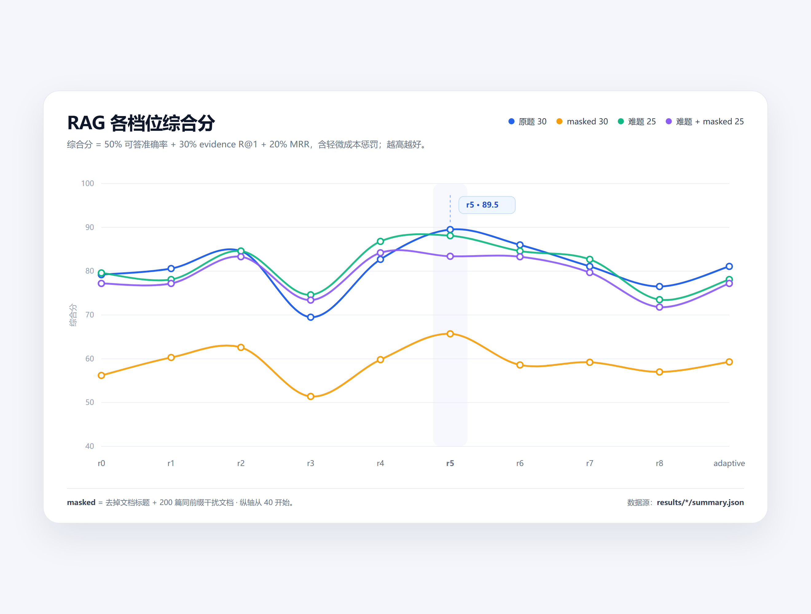
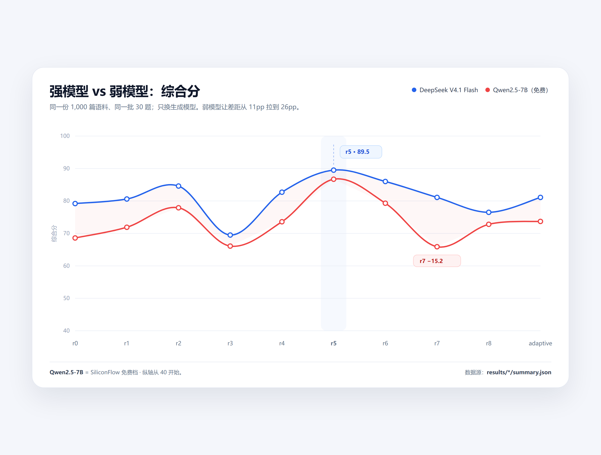

# baby-rag-history

**九个 RAG 里程碑，用一张 LangGraph 状态机跑在同一份中文维基语料上。**

同一份语料、同一批问题、同一个 4,000-token 上下文预算；每个 rung 只改检索链路的一个变量，
并同时记录效果、召回、弃答、延迟和成本。

> 读源码：[`learn/README.md`](learn/README.md) ·
> 逐函数代码漫游：[`learn/code-walkthrough/README.md`](learn/code-walkthrough/README.md) ·
> 文档索引：[`docs/README.md`](docs/README.md) ·
> 架构：[`docs/design.md`](docs/design.md) ·
> 完整结果：[`docs/results.md`](docs/results.md) ·
> 指标与协议：[`docs/evaluation.md`](docs/evaluation.md)

## 九个 rung

| rung | 里程碑 | 只改了什么 | 锚点 |
|---|---|---|---|
| `r0_dense` | Naive RAG | dense top-5 → 生成 | Lewis et al. 2020, arXiv:2005.11401 |
| `r1_hybrid` | Hybrid + RRF | 加 BM25 一路，RRF(k=60) | Cormack et al. 2009 |
| `r2_rerank` | Rerank | 召回 20 → bge-reranker 取 5 | Nogueira & Cho 2019, arXiv:1901.04085 |
| `r3_hyde` | HyDE | embed「假答案」而非问题 | Gao et al. 2022, arXiv:2212.10496 |
| `r4_multiquery` | Multi-Query | 1 问变 3 问 + RRF | Rackauckas 2024, arXiv:2402.03367 |
| `r5_contextual` | Contextual Retrieval | 索引期给 chunk 补定位说明 | Anthropic 2024-09 |
| `r6_raptor` | RAPTOR | 叶子 + 摘要树跨层检索 | Sarthi et al. 2024, arXiv:2401.18059 |
| `r7_crag` | CRAG / Self-RAG | 相关性评估 + 改写重查 + 弃答 | Yan et al. 2024 / Asai et al. 2023 |
| `r8_agentic` | Agentic ReAct | 最多 4 步 `SEARCH → OBSERVATION` | Yao et al. 2022, arXiv:2210.03629 |
| `adaptive` | Adaptive Router | 按题型/长度选上面一档 | Jeong et al. 2024, arXiv:2403.14403 |

**GraphRAG 不实现**：不是买不起，是 ROI/排期不划算。见 [`docs/graphrag-not-built.md`](docs/graphrag-not-built.md)。

## 架构

```text
START → plan → dispatch ─┬→ retrieve_dense / retrieve_hybrid / retrieve_contextual
                         ├→ retrieve_multi / retrieve_raptor
                         ├→ hyde / rewrite_multi_query / fuse_rrf / rerank
                         ├→ grade / agentic / verify / generate
                         └→ finalize → END
```

- **一张图 + 计划表**：`plan` 产出有序阶段列表，`dispatch` 读 `plan[cursor]` 决定下一步；
  每个 rung 只是 [`src/babyrag/rungs.py`](src/babyrag/rungs.py) 里的一行。
- **最终上下文固定 top-5 / 4,000 token**：所有 rung 同一预算。
- **`agentic` 是带循环的普通节点**，不是独立的 LangGraph 子图。
- **两套主索引变体**：`original` 与 `masked`（去标题 + 200 篇同前缀干扰文档）；
  另有 `public` 变体只用于 RAGBench 外部锚点。
- **生成/检索/评测阶段的 LLM 调用走 SQLite 缓存**，键 = stage + prompt_version + model + 输入哈希；
  `prepare_corpus` 的分类器是独立调用，不经过这层缓存。

实际编译出的图（19 节点 / 32 边）：[PNG](docs/graph.png) · [交互版 HTML](docs/graph.html)。

## 快速开始

```bash
uv sync
cp .env.example .env          # 填 OPENCODE_GO_API_KEY 与 SILICONFLOW_API_KEY

# 1) 数据：data/ 未入库（CC-BY-SA + 体积）。
#    从 rag-ladder 复制 corpus.jsonl / chunks.jsonl / eval/queries.jsonl 可直接用；
#    或从原始 parquet 重建：
uv run python -m scripts.prepare_corpus --size 1000 --classifier llm --workers 24
uv run python -m scripts.fix_long_sentences
uv run python -m scripts.build_chunks

# 2) 索引
uv run python -m scripts.build_index
uv run python -m scripts.build_contextual --index     # r5，约 4,740 次 LLM
uv run python -m scripts.build_raptor                 # r6
uv run python -m scripts.build_masked_corpus          # 可选：去标题 + 干扰文档
uv run python -m scripts.complete_masked_artifacts
uv run python -m scripts.build_index --variant masked --rebuild

# 3) 单题 / 全台阶
uv run babyrag ask "增禄的父亲咸成曾任什么官职？" --rung r2_rerank
uv run python -m scripts.run_eval --rungs all --workers 3
```

## 读源码

从 [`learn/README.md`](learn/README.md) 开始。它按调用链分成 7 篇：

| 篇 | 内容 |
|---|---|
| [一个问题的旅程](learn/01-a-question-journey.md) | 一次提问从头到尾发生了什么 |
| [数据与索引](learn/02-data-and-index.md) | 语料怎么变成可检索的卡片 |
| [检索的四种武器](learn/03-retrieval.md) | 语义、关键词、投票、精排各自干什么 |
| [九个台阶与一张图](learn/04-rungs-and-graph.md) | 9 个 rung 如何共用一张流水线 |
| [模型调用与省钱](learn/05-llm-and-cost.md) | 为什么缓存能省下大部分钱 |
| [怎么证明它有效](learn/06-evaluation.md) | 排行榜的数字到底怎么来的 |
| [动手改代码](learn/07-change-the-code.md) | 想改行为时从哪里下手 |

想逐函数读代码：[`learn/code-walkthrough/`](learn/code-walkthrough/README.md)。

## 数据

- **主语料**：`wikimedia/wikipedia` 20231101 中文 shard，LLM 五主题分类 + 嵌套抽样，
  **1,000 篇 / 5 主题各 200 / 4,740 chunks**（512 token / overlap 64）。
- **保留 30 题的 gold 文档**：LLM 分类有非确定性，重建时需把 `rag-ladder` 的原 200 篇
  `corpus.base.jsonl` 作为种子，用 `scripts/merge_corpus.py` 合并；否则 30 题里可能有 3 个
  gold 文档丢失。
- **masked 变体**：chunk 标题替换为「（标题已隐藏）」，另加 200 篇同标题前缀干扰文档，
  **1,200 篇 / 5,676 chunks**。
- **问题集**：30 道原题（single 12 / entity 6 / multi 6 / global 3 / none 3）；
  25 道公平手写难题；10 道回顾性 test split；25 道 RAGBench `emanual` 外部锚点。
- **许可**：语料 CC-BY-SA-4.0；`data/` 已 gitignore，仓库只保留脚本与结果。

## 结果（综合分）

`综合 = 100 × (0.50×可答 acc + 0.30×evidence R@1 + 0.20×MRR@10) / (1 + 100×cold $/q)`

| rung | 原题 30 | masked 30 | 难题 25 | 难题 + masked 25 |
|---|---:|---:|---:|---:|
| `r0_dense` | 79.2 | 56.2 | 79.6 | 77.2 |
| `r1_hybrid` | 80.6 | 60.3 | 78.1 | 77.2 |
| `r2_rerank` | 84.6 | 62.6 | 84.6 | 83.3 |
| `r3_hyde` | 69.5 | 51.4 | 74.6 | 73.4 |
| `r4_multiquery` | 82.7 | 59.8 | 86.8 | **84.2** |
| `r5_contextual` | **89.5** | **65.7** | **88.1** | 83.4 |
| `r6_raptor` | 86.0 | 58.6 | 84.6 | 83.3 |
| `r7_crag` | 81.1 | 59.2 | 82.7 | 79.7 |
| `r8_agentic` | 76.5 | 57.0 | 73.5 | 71.8 |
| `adaptive` | 81.1 | 59.3 | 78.1 | 77.2 |



> 橙色是 masked 变体，整条线比原题低约 20 分：标题泄漏对分数的贡献非常直观。
> 纵轴从 40 开始，便于看差异。

**弱模型对照**：把生成模型换成 SiliconFlow 免费的 `Qwen2.5-7B` 后，r0 掉到 63.0%、r7 掉到 63.0%，
r5 仍有 88.9%；准确率差距从 11pp 拉到 26pp。也就是说，**强模型确实会掩盖检索链路的差异**。



详见 [`docs/results.md`](docs/results.md)。

**四个稳定结论**：

- **r5 contextual** 赢 3/4 套；索引期补语境是这份语料上最有效的单点改动。
- **r2 rerank** 稳定前三，成本几乎不变，是性价比最高的一档。
- **r3 HyDE 反噬**：acc 不低，但 `evidence R@1` 只有 48.1% / 29.6%，假答案会挤掉正确 chunk。
- **r8 agentic** 的可答 acc 不领先，`evidence R@1` 偏低；多轮检索没有改善首轮命中。

完整评测表与解读：[`docs/results.md`](docs/results.md)。

**中段事实 50 题**（单独新集，五主题各 10，答案都在文档中段）：题面点名实体，`doc@1` 全部 100%，
差距全在文档内部。`r2`/`r5`/`r6` 的 `evidence R@1` 都是 96%，`r0` 72%，`r3` 70%。
这套题说明：**难的不是找文档，是在长文档里定位中段事实**。
换成 Qwen2.5-7B 后，`r5` 综合几乎不变（93.4 → 93.2），`r7` 掉 13.7 分，和 30 题主榜的结论一致。

## 成本

| 项 | 实测/估算 |
|---|---:|
| 语料生成（1,000 篇 LLM 分类） | $0.365 |
| 原 contextual + RAPTOR 索引 | ~$1.87 |
| masked contextual（复用前缀 + 替换标题 + 重新嵌入） | ~$0.45 |
| 全部评测 + judge + 校准 + 公开锚点 | ~$1.1 |
| **合计** | **~$3.8 / $10** |

硅基流动（bge-m3 + bge-reranker）实际花费 **¥0**。

## 目录

```text
src/babyrag/        # graph, retrieval, eval, llm, cache
scripts/            # 语料、索引、评测、重建
eval/               # queries.jsonl, queries-hard.jsonl, queries-test.jsonl, queries-manual50.jsonl
results/            # 每套评测的 leaderboard / summary / per_query / cost
docs/               # 设计、结果、指标、里程碑
research/           # 实现前研究（有过期假设）
```

## 限制

- 原题 30 道，global 和 no-answer 各只有 3 道；10 道 test split 是回顾性的，不是真 holdout。
- 难题集是 25 道单跳改写题，没有覆盖多跳/全局。
- 中段事实 50 题由作者读 chunk 后反写，选题时优先含数字的 chunk，存在选择偏差；它衡量“中段事实能否被检索到”，不代表真实用户的问题分布。
- masked 的 contextual 前缀是从原前缀派生的近似，没有重新跑 5,676 次 LLM；而且只去掉了 chunk 文本里的标题，metadata 的 `title` 仍会拼进上下文，属于**部分去偏**。
- faithfulness 只有 30 条抽样、单 judge，区分度低。
- 公开锚点只有 RAGBench `emanual` 的 25 题英文手册，不是中文语料的外部验证。
- 这是机制/成本/失败模式演示，不是论文复现：DPR 训练、Self-RAG reflection token、
  CRAG 网页回退都换成了同机制的 LLM/规则替代。

## License

代码 MIT。语料 CC-BY-SA-4.0，衍生自中文维基百科，需署名并以相同方式共享。
