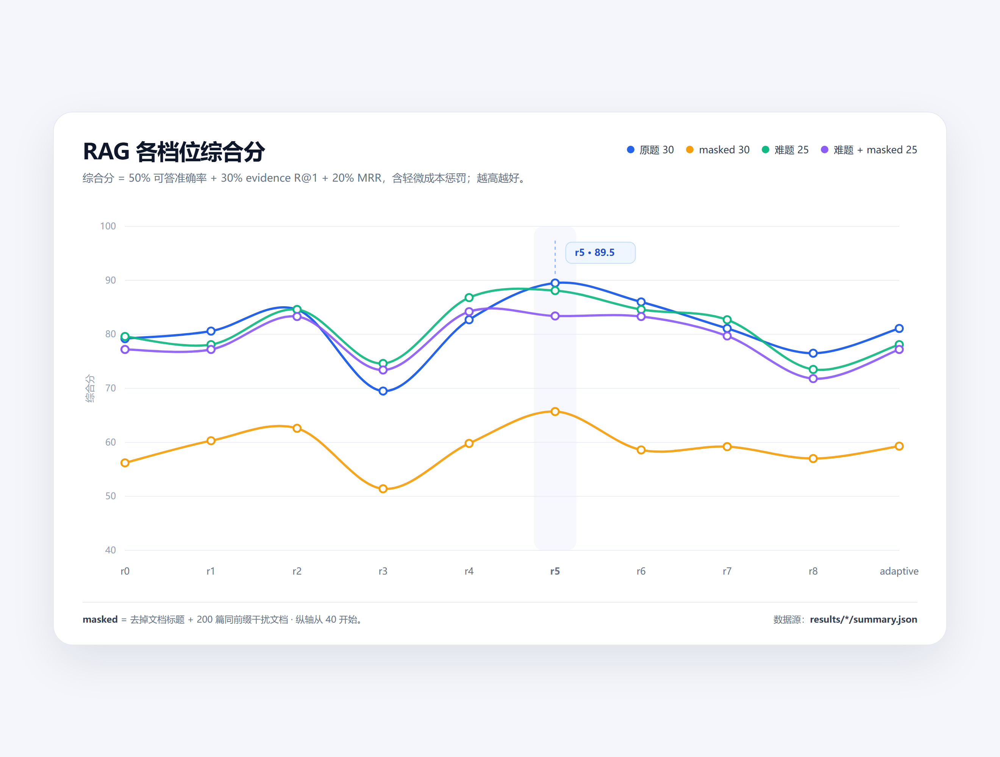
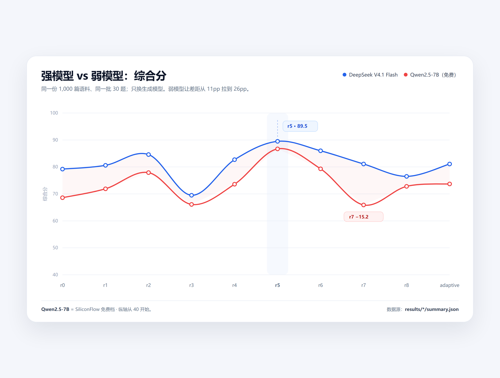

# 结果

> 所有数字来自 `results/*/summary.json`；生成表在 `results/*/leaderboard.md`。
> 指标定义见 [`evaluation.md`](evaluation.md)。

- `可答 acc`：只算可回答问题，所有 rung 同一分母（原题 27、难题 25）。
- `evidence R@k`：gold evidence 是否进入最终 top-k 上下文。
- `MRR@10`：gold evidence 第一次出现的排名倒数。
- `综合`：`100 × (0.50×可答 acc + 0.30×evidence R@1 + 0.20×MRR@10) / (1 + 100×cold $/q)`。

> 橙色是 masked 变体，整条线比原题低约 20 分：标题泄漏对分数的贡献非常直观。
> 纵轴从 40 开始，便于看差异。

## 1. 原题 30（原索引）

| rung | 可答 acc | evidence R@1 | evidence R@5 | MRR@10 | 综合 |
|---|---:|---:|---:|---:|---:|
| `r0_dense` | 88.9% | 74.1% | 96.3% | 0.747 | 79.2 |
| `r1_hybrid` | 88.9% | 77.8% | 96.3% | 0.762 | 80.6 |
| `r2_rerank` | 96.3% | 77.8% | 96.3% | 0.783 | 84.6 |
| `r3_hyde` | 96.3% | 48.1% | 96.3% | 0.628 | 69.5 |
| `r4_multiquery` | 92.6% | 81.5% | 96.3% | 0.789 | 82.7 |
| `r5_contextual` | **100.0%** | **85.2%** | **100.0%** | **0.833** | **89.5** |
| `r6_raptor` | 96.3% | 81.5% | 96.3% | 0.800 | 86.0 |
| `r7_crag` | 92.6% | 81.5% | 92.6% | 0.783 | 81.1 |
| `r8_agentic` | 88.9% | 77.8% | 96.3% | 0.762 | 76.5 |
| `adaptive` | 88.9% | 81.5% | 96.3% | 0.794 | 81.1 |

## 2. 原题 30（masked：去标题 + 200 篇干扰）

| rung | 可答 acc | evidence R@1 | evidence R@5 | MRR@10 | 综合 |
|---|---:|---:|---:|---:|---:|
| `r0_dense` | 70.4% | 44.4% | 63.0% | 0.473 | 56.2 |
| `r1_hybrid` | 77.8% | 44.4% | 70.4% | 0.500 | 60.3 |
| `r2_rerank` | 74.1% | 55.6% | 66.7% | 0.544 | 62.6 |
| `r3_hyde` | 77.8% | 29.6% | 70.4% | 0.398 | 51.4 |
| `r4_multiquery` | 70.4% | 55.6% | 66.7% | 0.544 | 59.8 |
| `r5_contextual` | 77.8% | **59.3%** | **70.4%** | **0.578** | **65.7** |
| `r6_raptor` | 66.7% | 55.6% | 63.0% | 0.528 | 58.6 |
| `r7_crag` | 74.1% | 55.6% | 63.0% | 0.528 | 59.2 |
| `r8_agentic` | 77.8% | 44.4% | 70.4% | 0.500 | 57.0 |
| `adaptive` | 77.8% | 44.4% | 70.4% | 0.500 | 59.3 |

**对照**：去标题后 `evidence R@1` 从 48–85% 掉到 30–59%，`可答 acc` 从 89–100% 掉到 67–78%。
原题的高分有相当一部分来自标题泄漏。

> 注意：masked 只去掉 chunk 文本与问题里的标题；`build_context` 仍会把 metadata 的 `title`
> 拼进上下文，所以是**部分去偏**，不是完全去标题。

## 3. 公平难题 25（原索引）

| rung | 可答 acc | evidence R@1 | evidence R@5 | MRR@10 | 综合 |
|---|---:|---:|---:|---:|---:|
| `r0_dense` | 92.0% | 68.0% | 96.0% | 0.797 | 79.6 |
| `r1_hybrid` | 92.0% | 64.0% | 96.0% | 0.777 | 78.1 |
| `r2_rerank` | 92.0% | 80.0% | 100.0% | 0.881 | 84.6 |
| `r3_hyde` | 88.0% | 72.0% | 96.0% | 0.803 | 74.6 |
| `r4_multiquery` | **96.0%** | **84.0%** | **100.0%** | **0.913** | 86.8 |
| `r5_contextual` | **96.0%** | **84.0%** | **100.0%** | 0.901 | **88.1** |
| `r6_raptor` | 92.0% | 80.0% | 100.0% | 0.881 | 84.6 |
| `r7_crag` | 92.0% | **84.0%** | **100.0%** | 0.901 | 82.7 |
| `r8_agentic` | 92.0% | 64.0% | 96.0% | 0.777 | 73.5 |
| `adaptive` | 92.0% | 64.0% | 96.0% | 0.777 | 78.1 |

## 4. 公平难题 25（masked）

| rung | 可答 acc | evidence R@1 | evidence R@5 | MRR@10 | 综合 |
|---|---:|---:|---:|---:|---:|
| `r0_dense` | 92.0% | 64.0% | 88.0% | 0.735 | 77.2 |
| `r1_hybrid` | 92.0% | 64.0% | 88.0% | 0.733 | 77.2 |
| `r2_rerank` | 92.0% | 80.0% | 84.0% | 0.813 | 83.3 |
| `r3_hyde` | 84.0% | 76.0% | 80.0% | 0.780 | 73.4 |
| `r4_multiquery` | **96.0%** | **80.0%** | **92.0%** | **0.840** | **84.2** |
| `r5_contextual` | 92.0% | 80.0% | 84.0% | 0.813 | 83.4 |
| `r6_raptor` | 92.0% | 80.0% | 84.0% | 0.813 | 83.3 |
| `r7_crag` | 92.0% | 80.0% | 84.0% | 0.813 | 79.7 |
| `r8_agentic` | 92.0% | 64.0% | 88.0% | 0.733 | 71.8 |
| `adaptive` | 92.0% | 64.0% | 88.0% | 0.733 | 77.2 |

## 5. 回顾性 test split（10 题）

| rung | 可答 acc | evidence R@1 | evidence R@5 | 综合 |
|---|---:|---:|---:|---:|
| `r0_dense` | 88.9% | 77.8% | 88.9% | 80.3 |
| `r1_hybrid` | 77.8% | 77.8% | 88.9% | 75.0 |
| `r2_rerank` | 88.9% | 88.9% | 88.9% | 84.6 |
| `r3_hyde` | 88.9% | 55.6% | 88.9% | 68.3 |
| `r4_multiquery` | 88.9% | 66.7% | 88.9% | 75.0 |
| `r5_contextual` | **100.0%** | **100.0%** | **100.0%** | **95.1** |
| `r6_raptor` | 88.9% | 88.9% | 88.9% | 84.6 |
| `r7_crag` | 88.9% | 88.9% | 88.9% | 81.4 |
| `r8_agentic` | 77.8% | 77.8% | 88.9% | 71.1 |
| `adaptive` | 77.8% | 77.8% | 88.9% | 74.3 |

> 这 10 道题在开发期已经见过，不是真 holdout；n=10 的 Wilson 区间很宽。

## 6. 中段事实 50（手写）

50 道题，五主题各 10；答案都取自文档中段，evidence 已校验落在 gold 文档中间三分之一的 chunk 内。
和原 30 题不重叠，单独成集，用来测“同一文档里，中段事实能不能被检索到”。

| rung | 可答 acc | evidence R@1 | evidence R@5 | MRR@10 | 综合 |
|---|---:|---:|---:|---:|---:|
| `r0_dense` | 92.0% | 72.0% | 96.0% | 0.827 | 81.8 |
| `r1_hybrid` | 96.0% | 82.0% | 98.0% | 0.892 | 87.8 |
| `r2_rerank` | 96.0% | **96.0%** | 98.0% | **0.970** | **93.5** |
| `r3_hyde` | 96.0% | 70.0% | 98.0% | 0.805 | 78.6 |
| `r4_multiquery` | 94.0% | 90.0% | 98.0% | 0.940 | 88.8 |
| `r5_contextual` | 96.0% | **96.0%** | 98.0% | **0.970** | 93.4 |
| `r6_raptor` | 96.0% | **96.0%** | 98.0% | **0.970** | **93.5** |
| `r7_crag` | 96.0% | **96.0%** | 98.0% | **0.970** | 90.9 |
| `r8_agentic` | 96.0% | 82.0% | 98.0% | 0.890 | 83.6 |
| `adaptive` | 96.0% | 82.0% | 98.0% | 0.890 | 87.8 |

**读法**：

- **`doc@1` 全部 100%**：题面点名了实体或作品，找到文档不再是难点，难度全在“文档里的哪一段”。
- **`r2` / `r5` / `r6` 的 `evidence R@1` 都是 96%**，几乎到顶；这套题对它们的区分度很小。
- **`r0` 只有 72%**：纯向量在中段事实上会漏，hybrid 把 R@1 拉到 82%。
- **`r3` HyDE 仍是重写查询里最差的（70%）**，和主榜一致：假答案会挤掉正确 chunk。
- **`r8` 82%**，低于 r2/r5/r6，多轮检索没有改善首轮命中。

**弱模型对照（Qwen2.5-7B）**：同一批 50 题、同一索引，只换生成/judge 模型：

| rung | DeepSeek acc | Qwen acc | Δ | DeepSeek 综合 | Qwen 综合 | Δ |
|---|---:|---:|---:|---:|---:|---:|
| `r0_dense` | 92.0% | 80.0% | -12.0 | 81.8 | 78.1 | -3.7 |
| `r1_hybrid` | 96.0% | 80.0% | -16.0 | 87.8 | 82.4 | -5.4 |
| `r2_rerank` | 96.0% | 86.0% | -10.0 | 93.5 | 91.2 | -2.3 |
| `r3_hyde` | 96.0% | 86.0% | -10.0 | 78.6 | 81.3 | **+2.7** |
| `r4_multiquery` | 94.0% | 80.0% | -14.0 | 88.8 | 87.4 | -1.4 |
| `r5_contextual` | 96.0% | 90.0% | **-6.0** | 93.4 | **93.2** | **-0.2** |
| `r6_raptor` | 96.0% | 86.0% | -10.0 | 93.5 | 91.2 | -2.3 |
| `r7_crag` | 96.0% | 72.0% | **-24.0** | 90.9 | 77.2 | -13.7 |
| `r8_agentic` | 96.0% | 80.0% | -16.0 | 83.6 | 82.4 | -1.2 |
| `adaptive` | 96.0% | 80.0% | -16.0 | 87.8 | 82.4 | -5.4 |

- **`r5` 最稳**：acc 只掉 6pp，综合几乎不变（-0.2），和 30 题上的结论一致——索引期补语境不依赖生成模型强度。
- **`r7` 崩得最狠**：-24pp。CRAG 的 grader 也是同一个弱模型，过滤/重查反而伤。
- **`r3` 综合反而 +2.7**，不是模型变强，而是 DeepSeek 的 r3 有 HyDE 的额外成本惩罚（$0.00083/q），Qwen 免费档记 $0，没有惩罚。**跨模型的综合分不能直接比效率**。
- `evidence R@1` 在 judge 无关的地方基本不变：r2/r5/r6 都还是 96%；r3（70→72）和 r7（96→82）因为检索链路本身调用了模型，才有变化。

完整表：`results/manual50/leaderboard.md`、`results/siliconflow-qwen-qwen25-7b-instruct-manual50/leaderboard.md`。这套题的可答率普遍高于主榜，说明**难的不是找文档，是在长文档里定位中段事实**；而这一项最吃 rerank 和索引期补语境。

## 7. RAGBench 外部锚点（25 题英文手册）

只跑 6 个代表 rung；r5/r6 没有公共索引。

| rung | 可答 acc | evidence R@1 | evidence R@5 | MRR@10 | 综合 |
|---|---:|---:|---:|---:|---:|
| `r0_dense` | 52.0% | 57.1% | 92.9% | 0.750 | 55.6 |
| `r1_hybrid` | 56.0% | 57.1% | 92.9% | 0.720 | 56.8 |
| `r2_rerank` | **60.0%** | 78.6% | **100.0%** | **0.893** | **67.6** |
| `r4_multiquery` | 44.0% | 64.3% | **100.0%** | 0.821 | 54.0 |
| `r7_crag` | **60.0%** | **85.7%** | 92.9% | **0.893** | **67.6** |
| `r8_agentic` | 56.0% | 57.1% | 92.9% | 0.720 | 54.3 |

**外部结论**：`r2 rerank` 仍然最强，和中文主榜一致；`r4 multi-query` 在英文手册上掉到 44%，
说明查询改写的收益高度依赖语料和题型。

## 8. Faithfulness（抽样 30 条）

| 项 | 结果 |
|---|---|
| `supported=1.0` | 29 / 30（1 条 JSON 解析失败，平均值排除） |
| `citation_ok` | 29 / 29 有效样本为真 |
| 解读 | judge 偏宽松、答案多直接引用上下文，**不适合给 rung 排名** |

## 9. 弱模型对照：Qwen2.5-7B（SiliconFlow 免费）

把生成模型从 DeepSeek V4.1 Flash 换成 `Qwen/Qwen2.5-7B-Instruct`，其余设置不变：

| rung | DeepSeek acc | Qwen acc | Δ | DeepSeek 综合 | Qwen 综合 | Δ |
|---|---:|---:|---:|---:|---:|---:|
| `r0_dense` | 88.9% | 63.0% | -25.9 | 79.2 | 68.6 | -10.6 |
| `r1_hybrid` | 88.9% | 66.7% | -22.2 | 80.6 | 71.9 | -8.7 |
| `r2_rerank` | 96.3% | 77.8% | -18.5 | 84.6 | 77.9 | -6.7 |
| `r3_hyde` | 96.3% | 72.0% | -24.3 | 69.5 | 66.1 | -3.4 |
| `r4_multiquery` | 92.6% | 73.1% | -19.5 | 82.7 | 73.6 | -9.1 |
| `r5_contextual` | **100.0%** | **88.9%** | **-11.1** | 89.5 | **86.7** | **-2.8** |
| `r6_raptor` | 96.3% | 77.8% | -18.5 | 86.0 | 79.3 | -6.7 |
| `r7_crag` | 92.6% | **63.0%** | **-29.6** | 81.1 | 65.9 | -15.2 |
| `r8_agentic` | 88.9% | 69.2% | -19.7 | 76.5 | 72.8 | -3.7 |
| `adaptive` | 88.9% | 66.7% | -22.2 | 81.1 | 73.7 | -7.4 |

**读法**：

- 弱模型把准确率差距从 11pp 拉到 **26pp**（63.0–88.9%）。
- **r5 contextual 最稳**：acc 只掉 11.1pp，综合分只掉 2.8；检索层补语境不依赖模型强度。
- **r7 CRAG 崩得最狠**：-29.6pp。CRAG 的 grader 也是同一个弱模型，判断力不够，过滤/重查反而伤。
- **r3 HyDE 也明显变差**：弱模型写的假答案质量更差，检索被带偏。
- **r2 rerank 仍然稳**：-18.5pp，但仍是第二高的 acc；rerank 本身是免费的独立模型，不受生成模型影响。
- 综合分差距没有准确率那么大，因为 `evidence R@1` / MRR 主要由检索决定，换生成模型不会改变它们。

**重要限制**：judge 也换成了 Qwen2.5-7B，所以「正确/错误」判定本身变弱、噪声更大；`evidence R@k` 和 MRR 是 judge 无关的。另有 5 条 API 错误（451/400/503）已从分母剔除，见 leaderboard 的 `err` 列。

完整表：`results/siliconflow-qwen-qwen25-7b-instruct/leaderboard.md`。中段事实 50 题的弱模型结果见第 6 节。

## 10. 一句话总结

- **r5 contextual** 赢原题、masked、难题三套；索引期补语境是最有效的单点改动。
- **r4 multi-query** 赢「难题 + masked」，但在英文手册上反噬。
- **r2 rerank** 稳定前三，成本最低，是性价比最高的一档。
- **r3 HyDE** 的 `evidence R@1` 最差（29.6–48.1%），假答案会挤掉正确 chunk。
- **r8 agentic** 的可答 acc 不领先，`evidence R@1` 偏低：多查几次没有让首轮更准。
- **中段事实 50 题**把文档定位变成 100%，差距全在文档内部：`r2`/`r5`/`r6` 的 `evidence R@1` 都到 96%，`r0` 只有 72%，`r3` 70%。
