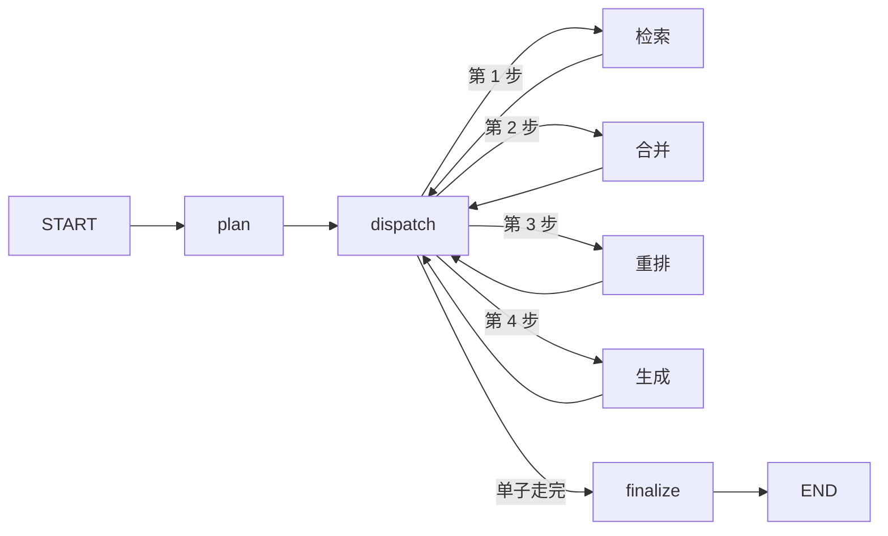

# 一个问题的旅程

我们先不打开代码。想象你输入了这句话，按下回车：

> 开姆尼茨工业大学的前身创办于哪一年？

接下来发生的事，可以分成六步。

## 第一步：准备

程序先做三件准备工作：

1. 读配置：API key、模型名、索引放在哪。
2. 准备两个“服务员”：一个负责检索（`Services`），一个负责调用大模型（`LLMClient`）。
3. 搭好流水线（`build_graph`）。

你可以把它想成：**开火前先把灶台、食材、菜谱摆好。**

## 第二步：填一张表

程序拿出一个空表格，写上：

| 字段 | 值 |
|---|---|
| `question` | 开姆尼茨工业大学的前身创办于哪一年？ |
| `rung` | `r2_rerank` |
| `plan` | 空 |
| `cursor` | 0 |
| `hits` | 空 |
| `answer` | 空 |

这张表会在整个流程里被不断更新。代码里叫 `RAGState`。`run_one` 一开始只填必要字段：

```python
state = {
    "qid": qid, "question": question, "rung": rung, "mode": mode,
    "qtype": qtype, "retries": 0, "node_records": [], "trajectory": [],
}
```

## 第三步：看工序单

如果你选的是 `r2_rerank`，工序单就是 `RUNGS` 里的一行：

```python
RUNGS["r2_rerank"]
# ["retrieve_hybrid", "fuse_rrf", "rerank", "generate"]
```

用大白话：

1. 先用两种办法各找一批卡片；
2. 把两批排名合并；
3. 把最相关的 5 张重新排一遍；
4. 看着这 5 张写答案。

这张工序单在 `rungs.py` 里，只有一行。**九个 rung 的差别，就是这行字不同。**

## 第四步：检索

“两种办法”是：

- **语义检索**：把问题和卡片都变成一串数字，找数字最接近的。
- **关键词检索**：看谁包含“开姆尼茨”“工业大学”“1836”这些词。

两边各拿 10 张，合并后留 20 张。这一步不花钱，只花几十毫秒。

## 第五步：排序

20 张里有很多“看起来相关、其实没用”的卡片。程序把问题和每张卡片**放在一起**，
让一个专门的重排模型读一遍，重新打分，只留 5 张。

这一步也不花钱（这个重排模型免费），但会比上一步慢一点。

## 第六步：写答案

5 张卡片被拼成一段带编号的资料：

```text
[1] （开姆尼茨工业大学）...成立于1836年...
[2] ...
```

然后告诉大模型：**只依据资料回答，每个结论后面标 [编号]，资料不够就说“无法回答”。**

模型写出：

> 开姆尼茨工业大学的前身创办于 1836 年。[1]

生成前有两条硬规则，代码里就是这两行：

```python
hits = (state.get("hits") or [])[:5]          # 最多 5 张卡片
context, kept = build_context(hits, ...)     # 按 4,000 token 截断
```

最后，程序把这次调用花了多少 token、多少钱、多少毫秒记下来。

## 为什么要有“工序单”和“工头”

如果每个 rung 都写一套代码，会有九套几乎一样的流水线，改一个 bug 要改九次。

所以这里只搭**一张流水线**，再用一张“工序单”告诉它今天走哪几步：

- `plan`：读工序单。
- `dispatch`：工头，看单子上的第 `cursor` 步，喊下一个工人。
- 每个工人干完活，把 `cursor` 加一，回到工头。
- 单子走完，收盘。



工头判断下一步，只看三行：

```python
plan = state.get("plan") or []
cursor = int(state.get("cursor", 0))
return plan[cursor] if cursor < len(plan) else "finalize"
```

这就是 LangGraph 在这里的全部作用：**把“下一步做什么”变成数据，而不是写死在代码里。**

## 如果你只记一件事

> 九个 rung 共用同一条流水线；它们的不同，只是一张更短或更长的工序单。

## 想深入看代码

- 入口：[cli.py:35](../src/babyrag/cli.py#L35)
- 初始表格：[graph.py:289](../src/babyrag/graph.py#L289)
- 工序单：[rungs.py:5](../src/babyrag/rungs.py#L5)
- 工头：[graph.py:58](../src/babyrag/graph.py#L58) 和 [graph.py:74](../src/babyrag/graph.py#L74)
- 拼上下文：[retrieval.py:210](../src/babyrag/retrieval.py#L210)
- 写答案：[graph.py:230](../src/babyrag/graph.py#L230)

## 检查一下

**问：** 为什么 `cursor` 每次都要加一？

**答：** 因为工序单是一个有序列表，`cursor` 记住走到第几步。加一之后，工头下一次就会喊下一个工人；走完就收盘。
