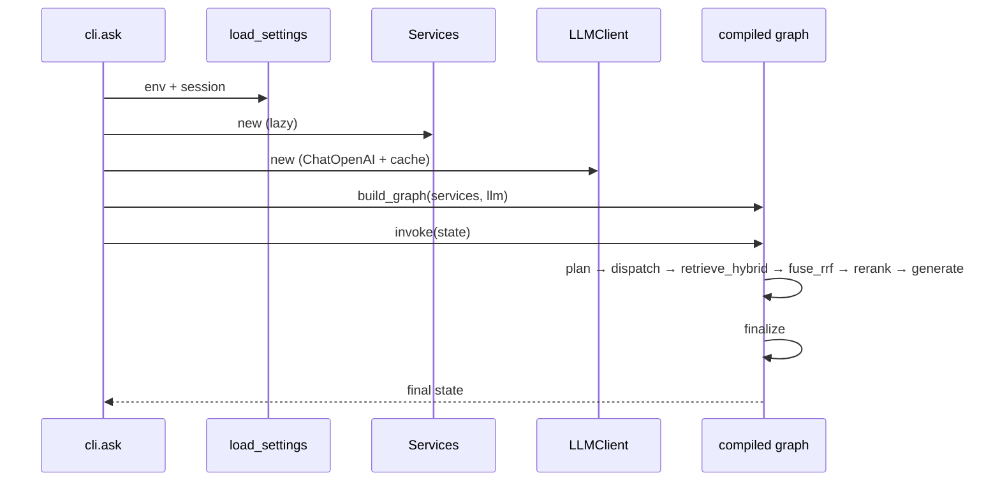

# 一次请求的生命周期

这一节只追一条线：`uv run babyrag ask "..." --rung r2_rerank` 从参数到答案。

## 入口

```python
# src/babyrag/cli.py:35
def ask(question: str, rung: str = typer.Option("r1_hybrid", ...), mode: str = ...):
    settings = load_settings()
    services = Services(settings)
    llm = LLMClient(settings)
    graph = build_graph(services, llm)
    result = run_one(graph, question=question, rung=rung, mode=mode)
```

对应代码：[cli.py:35](../src/babyrag/cli.py#L35) · [config.py:99](../src/babyrag/config.py#L99) ·
[retrieval.py:94](../src/babyrag/retrieval.py#L94) · [llm.py:43](../src/babyrag/llm.py#L43) ·
[graph.py:261](../src/babyrag/graph.py#L261) · [graph.py:281](../src/babyrag/graph.py#L281)

四件事：

1. `load_settings()` 读 `.env`，校验 `OPENCODE_GO_API_KEY`，生成/复用 `x-opencode-session`。
2. `Services(settings)` 是**懒加载**的检索器容器；构造时不会连 Chroma。
3. `LLMClient(settings)` 构造 `ChatOpenAI` 和 SQLite 缓存。
4. `build_graph()` 编译状态机；`run_one()` 只负责塞初始 state、调用、整理返回值。



## 初始 state

[graph.py:281](../src/babyrag/graph.py#L281)：

```python
state = {
    "qid": qid, "question": question, "rung": rung, "mode": mode,
    "qtype": qtype, "retries": 0, "node_records": [], "trajectory": [],
}
result = graph.invoke(state, config={"recursion_limit": 60})
```

`RAGState` 是 `total=False`，所以只放必要字段。`node_records` 和 `trajectory` 有
`Annotated[..., operator.add]` reducer（[types.py:72](../src/babyrag/types.py#L72)），
每个节点返回的是**增量**，LangGraph 负责拼起来。

## 图怎么走

[graph.py:261](../src/babyrag/graph.py#L261) 的连边：

- `START → plan`
- `plan → dispatch`
- `dispatch` 的条件边调用 `route`，返回 `plan[cursor]` 或 `"finalize"`
- 每个阶段节点都有一条静态边回到 `dispatch`
- `finalize → END`

```python
# graph.py:74
def route(self, state):
    plan = state.get("plan") or []
    cursor = int(state.get("cursor", 0))
    return plan[cursor] if cursor < len(plan) else "finalize"

# graph.py:71
def dispatch(self, state):
    return {}
```

`dispatch` 不做任何事，它只是**同步点**：让条件边有地方读最新的 `plan/cursor`。
每个阶段节点返回 `cursor + 1`，于是下一轮 `route` 自然走到下一阶段。

## r2 的一条实际轨迹

`r2_rerank` 的计划是 `["retrieve_hybrid", "fuse_rrf", "rerank", "generate"]`
（[rungs.py:8](../src/babyrag/rungs.py#L8)）。

| 步骤 | 节点 | 写入 state | cursor |
|---|---|---|---|
| 1 | `plan` | `plan=[...]`, `cursor=0`, `route_reason="ladder:r2_rerank"` | 0 |
| 2 | `dispatch` | 无 | 0 |
| 3 | `retrieve_hybrid` | `dense_hits`, `bm25_hits` | 1 |
| 4 | `fuse_rrf` | `hits`（融合后的 20 条） | 2 |
| 5 | `rerank` | `hits`（精排后的 5 条） | 3 |
| 6 | `generate` | `answer`, `citations`, `hits`（实际进上下文的） | 4 |
| 7 | `dispatch` | 无 | 4 |
| 8 | `finalize` | `cost` | — |

对应实现：[retrieve_hybrid:84](../src/babyrag/graph.py#L84) ·
[fuse_rrf:107](../src/babyrag/graph.py#L107) · [rerank:118](../src/babyrag/graph.py#L118) ·
[generate:230](../src/babyrag/graph.py#L230) · [finalize:255](../src/babyrag/graph.py#L255)

## 生成阶段的三个约束

[graph.py:230](../src/babyrag/graph.py#L230)：

```python
hits = (state.get("hits") or [])[:5]          # 公平：最多 5 条
context, kept = build_context(hits, services=self.services, budget=MAX_CONTEXT_TOKENS)
if not kept: return {"answer": "无法回答", "abstain": True, "hits": []}
...
abstain = answer.startswith("无法回答") and len(answer) < 20
```

- **top-5** 是硬规则，不因 rung 变化。
- `build_context`（[retrieval.py:210](../src/babyrag/retrieval.py#L210)）按 token 预算截断，
  可能少于 5 条；`kept` 才是实际进上下文的列表，引用编号基于它。
- “无法回答”只在很短时算弃答；长回答里带“无法回答”不会误判。

## 返回值

`run_one` 不直接把 LangGraph 的 state 丢给调用方，而是整理成
[qid, rung, question, answer, abstain, citations, hits, plan, route_reason, cost, node_records]
（[graph.py:292](../src/babyrag/graph.py#L292)）。`hits` 里保留 `text` 和 `doc_ids`，
因为评测要计算 evidence recall。

## Check yourself

1. 为什么 `dispatch` 是一个空节点，而不是直接在 `route` 里做事？
2. 如果某个节点的 `plan` 为空，图会怎么走？
3. `recursion_limit=60` 是做什么的？去掉会怎样？

### Answers

1. LangGraph 的条件边需要一个“当前节点”来触发；`dispatch` 提供稳定的同步点，让 `route` 读最新 state。把副作用放进 `route` 会让路由函数不纯、难测试。
2. `route` 看到 `cursor=0 >= len([])`，直接返回 `"finalize"`，图走 `finalize → END`。
3. 限制单次 `invoke` 的 super-step 数，防止节点/条件边写错导致死循环。去掉会回退到框架默认值，出错时可能跑很久才报错。
