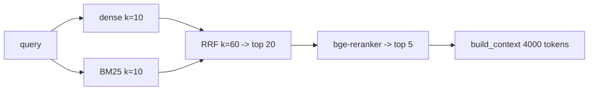

# 检索层

`retrieval.py` 提供两件事：**取回候选**和**把候选拼成上下文**。它不调用生成模型。

## 两个检索器

### DenseRetriever

[retrieval.py:34](../src/babyrag/retrieval.py#L34)：

```python
with _INIT_LOCK:
    self.store = Chroma(collection_name=collection, embedding_function=build_embeddings(settings), ...)
```

`_INIT_LOCK`（[retrieval.py:22](../src/babyrag/retrieval.py#L22)）是给评测线程用的：
Chroma 的 embedded client 在同一个 `persist_directory` 上并发初始化会报
`Could not connect to tenant` / `RustBindingsAPI` 错误，所以串行化构造。

`search`（[retrieval.py:47](../src/babyrag/retrieval.py#L47)）把 Chroma 的 `(Document, score)`
转成 `Chunk`：

- `score` 是**距离**（cosine 越小越近），不要当相似度用。
- `doc_ids` 从 metadata 的 `doc_ids`（`|` 分隔）解析；RAPTOR 摘要会覆盖多个文档。
- `level` 区分叶子和摘要。

### BM25Retriever

[retrieval.py:68](../src/babyrag/retrieval.py#L68)：

```python
self._tokens = [tokenize(r[text_field]) for r in rows]
self._bm25 = BM25Okapi(self._tokens)
```

`tokenize`（[retrieval.py:30](../src/babyrag/retrieval.py#L30)）用 jieba，再用正则过滤纯标点。
查询和索引必须用**同一个** tokenizer，否则分数不可比。

`search` 里 `if scores[i] <= 0: continue` 会丢掉零分文档；这避免把完全不相关的 chunk 塞进 RRF。

## Services：懒加载的容器

[retrieval.py:94](../src/babyrag/retrieval.py#L94)。它不继承任何东西，只持有：

| 属性 | 类型 | 什么时候建 |
|---|---|---|
| `dense` | `DenseRetriever` | 第一次访问 |
| `contextual_dense` | `DenseRetriever` | r5 第一次访问 |
| `raptor` | `DenseRetriever` | r6 第一次访问 |
| `bm25` | `BM25Retriever` | 第一次访问，从 `chunks` 建 |
| `contextual_bm25` | `BM25Retriever` | r5 第一次访问，从 `contextual.jsonl` 建 |

```python
@property
def dense(self):
    if self._dense is None:
        self._dense = DenseRetriever(self.settings, self.paths["dense"])
    return self._dense
```

`paths` 来自 `Settings.paths`，所以切换 `original/masked/public` 只改 `BABYRAG_VARIANT`。

`count_tokens`（[retrieval.py:157](../src/babyrag/retrieval.py#L157)）用 tiktoken，给
`build_context` 算预算。

## RRF：按排名融合，不按分数

[retrieval.py:171](../src/babyrag/retrieval.py#L171)：

```python
scores[cid] += 1.0 / (k + rank)
```

- `k=60`（[retrieval.py:20](../src/babyrag/retrieval.py#L20)）。
- 只看排名，避免 dense 距离和 BM25 分数尺度不同的问题。
- 同一个 chunk 在多路里出现，分数累加；`best[cid]` 保留分数最高的原始 hit（用于 `text/doc_ids`）。
- 输出 `source="rrf"`，分数是 RRF 分，不是原始相似度。

## Rerank：用 cross-encoder 重排

[retrieval.py:193](../src/babyrag/retrieval.py#L193)：

```python
pairs = rerank(settings, query, [h["text"] for h in hits], top_n=top_n)
for index, score in pairs:
    hit = dict(hits[index])
```

SiliconFlow 返回的是**输入列表下标**，所以必须用 `hits[index]` 映射回 Chunk。
`score` 此时是相关性分数（越大越好），与 dense 距离方向相反。

## 上下文拼装

[retrieval.py:210](../src/babyrag/retrieval.py#L210)：

```python
piece = f"[{len(kept) + 1}] （{title}）{body}"
cost = services.count_tokens(piece)
if used + cost > budget:
    continue
kept.append(hit)
```

- 编号基于 `kept`，不是原始 hits；所以 `extract_citations` 也用 `kept`
  （[retrieval.py:228](../src/babyrag/retrieval.py#L228)）。
- 超出 4,000 token 的 chunk 会被**跳过**，后面更小的 chunk 仍可能进来。
- `title` 会拼进上下文；masked 变体的 chunk 文本已经把标题替换掉，但 metadata 里仍有 title，
  这是为什么 masked 的上下文里还能看到标题前缀——评测时要注意。

## 一条检索链



r1 到 r2 的区别只是最后有没有 `X`；r5 把 `D`/`B` 换成 contextual collection；
r6 把 `D` 换成「叶子 + 摘要」两路再融合。

## Check yourself

1. 为什么 RRF 不直接相加 dense 和 BM25 的原始分数？
2. `build_context` 跳过一个大 chunk 后，为什么后面的 chunk 还能进来？
3. RAPTOR 的摘要节点为什么也要参与检索，而不是只查摘要？

### Answers

1. 两路分数尺度不同（cosine 距离 vs BM25 分数），直接加会被某一路支配；RRF 只看排名，天然可比。
2. 它维护的是累计 token `used`，不是“遇到第一个超预算就停”；跳过后继续尝试后面的更小 chunk。
3. 只用摘要会丢事实细节；RAPTOR 的正确用法是 collapsed tree：叶子 + 摘要一起检索，再精排。
