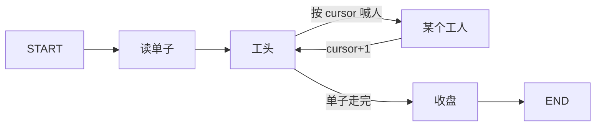

# 九个台阶与一张图

这一节回答两个问题：

1. 九个 rung 具体差在哪？
2. 为什么它们能共用一张图？

## 九个台阶，九张工序单

| rung | 工序单（大白话） | 多了什么 |
|---|---|---|
| `r0_dense` | 语义找 5 张 → 写答案 | 基线 |
| `r1_hybrid` | 语义 + 关键词 → 合并 → 写答案 | 多一路检索 |
| `r2_rerank` | 语义 + 关键词 → 合并 → 精排 → 写答案 | 多一步精排 |
| `r3_hyde` | 先写“假答案” → 用它检索 → 精排 → 写答案 | 换查询的写法 |
| `r4_multiquery` | 把问题改写成 3 个 → 各查一遍 → 合并 → 精排 | 多几个查询 |
| `r5_contextual` | 用“带上下文说明”的卡片检索 → 精排 | 换索引 |
| `r6_raptor` | 原始卡片 + 摘要卡片一起查 → 精排 | 多一层摘要 |
| `r7_crag` | 检索 → 精排 → 先判断靠不靠谱 → 再答/重查/弃答 | 多一步自检 |
| `r8_agentic` | 想 → 查 → 看，最多 4 轮 → 写答案 | 多轮检索 |
| `adaptive` | 看题型，选上面某一张单子 | 不是新能力，是选路 |

代码里就是 `RUNGS` 这个字典（[rungs.py:5](../src/babyrag/rungs.py#L5)）。字符串是节点名，顺序就是执行顺序：

```python
RUNGS = {
    "r0_dense":       ["retrieve_dense", "generate"],
    "r1_hybrid":      ["retrieve_hybrid", "fuse_rrf", "generate"],
    "r2_rerank":      ["retrieve_hybrid", "fuse_rrf", "rerank", "generate"],
    "r3_hyde":        ["hyde", "retrieve_hybrid", "fuse_rrf", "rerank", "generate"],
    "r4_multiquery":  ["rewrite_multi_query", "retrieve_multi", "fuse_rrf", "rerank", "generate"],
    "r5_contextual":  ["retrieve_contextual", "fuse_rrf", "rerank", "generate"],
    "r6_raptor":      ["retrieve_raptor", "rerank", "generate"],
    "r7_crag":        ["retrieve_hybrid", "fuse_rrf", "rerank", "grade", "generate"],
    "r8_agentic":     ["agentic", "verify", "generate"],
}
```

## 一张图怎么跑九张单子

图的骨架只有四个角色：



- `plan`：把 `RUNGS[rung]` 复制到 `state["plan"]`。
- `dispatch`：什么都不做，只是让条件边有地方读最新状态。
- `route`：看 `plan[cursor]`，返回下一个工人的名字；走完返回 `finalize`。
- 每个工人干完，`cursor + 1`，回到工头。

所以“新增一个 rung”通常只需要在 `RUNGS` 加一行；只有新增**节点**时才要改图。

读单和派工的代码也很短：

```python
# plan：把工序单复制进 state
if mode == "ladder":
    plan = list(RUNGS[rung])
else:
    rung, reason = adaptive_plan(state["question"], state.get("qtype"))
    plan = list(RUNGS[rung])

# route：看 cursor 决定下一步
return plan[cursor] if cursor < len(plan) else "finalize"
```

## 走一遍 r2

1. `plan` 读出 `["retrieve_hybrid", "fuse_rrf", "rerank", "generate"]`。
2. 工头喊 `retrieve_hybrid`：语义找 10 张、关键词找 10 张。
3. `fuse_rrf`：把两批排名合并，留 20 张。
4. `rerank`：精排，留 5 张。
5. `generate`：写答案，标引用。
6. 收盘，算钱。

## 走一遍 r7

r7 在 `generate` 前多了一个 `grade`：

- 它把前 6 张卡片交给模型，问：“这些资料能回答问题吗？”
- 如果能，过滤掉不相关的，继续。
- 如果明显不行，改写问题，再查一次；最多重查一次。
- 如果模型输出“无法回答”，最后会计入弃答。

这就是 CRAG 的核心：**先判断资料靠不靠谱，再决定答不答。** 核心代码（省略了拼 prompt）：

```python
hits = (state.get("hits") or [])[:6]
retries = int(state.get("retries", 0))
result = self.llm.invoke(GRADE.format(question=..., chunks=...), stage="grade")
relevant, verdict = parse_relevant(result.text, len(hits))
if verdict == "incorrect" and retries < 1:
    ...  # 改写查询 -> 重新检索 -> 重新精排
if relevant:
    hits = [hits[i - 1] for i in relevant if 1 <= i <= len(hits)]
```

## 走一遍 r8

r8 把检索变成“工具”，让模型自己决定查什么：

1. 先拿原始问题查一次，占住 5 个位置。
2. 模型输出 `SEARCH: 某个词`，程序去查，把结果放进“历史”。
3. 模型看到结果，再决定继续查还是输出 `FINAL:`。
4. 最多 4 轮。

代价是慢：每次都要调用模型，而且历史越来越长。循环本体：

```python
for step in range(4):
    result = self.llm.invoke(AGENTIC.format(question=..., history=...), stage="agentic")
    if "FINAL:" in result.text:
        break
    query = result.text.split("SEARCH:", 1)[-1].strip()
    hits = fuse_rrf(*self._hybrid(query), top_n=5)
    for hit in hits:
        collected.setdefault(hit["chunk_id"], hit)   # 不覆盖 baseline
    history.append(f"SEARCH: {query}\nOBSERVATION: ...")
```

## 一个容易误解的地方

九个 rung 是**累积**的，不是单变量实验。

比如 `r3_hyde` 同时拥有混合检索和精排；它比 r2 差，只能说明“在 r2 基础上加 HyDE 的净效果”，
不能单独说“HyDE 本身一定差”。

真正公平的单变量对比，需要另建实验，只改一个开关。

## 如果你只记一件事

> 九个 rung 是九张工序单，共用一张流水线；`plan` 读单，`dispatch` 按单喊人，
> 每个工人做完把 `cursor` 加一。

## 想深入看代码

- 工序单：[rungs.py:5](../src/babyrag/rungs.py#L5)
- 读单/派工：[graph.py:58](../src/babyrag/graph.py#L58)、[graph.py:74](../src/babyrag/graph.py#L74)
- 自检：[graph.py:168](../src/babyrag/graph.py#L168)
- 多轮：[graph.py:198](../src/babyrag/graph.py#L198)
- 建图：[graph.py:261](../src/babyrag/graph.py#L261)

## 检查一下

**问：** 为什么 `r7_crag` 的 `grade` 放在 `generate` 前面，而不是后面？

**答：** 它要在写答案之前判断资料靠不靠谱；不靠谱就重查或弃答，避免“拿着错资料硬写”。
