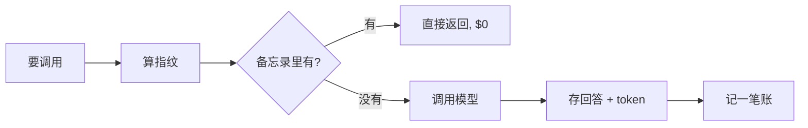

# 模型调用与省钱

这一节解释：**为什么同样的问题跑第二遍几乎不花钱。**

## 一次模型调用像打一通付费电话

你每问一次模型，就按“说了多少字、回了多少字”计费。

这个项目用的模型是 DeepSeek V4.1 Flash，价格大约：

- 输入：$0.15 / 100 万 token
- 输出：$0.60 / 100 万 token

一次普通回答大约 2,600 输入 + 300 输出，也就是 **$0.0006** 左右。
30 道题 × 10 个 rung，纯答题大约 $0.2。

真正贵的是**索引**：给 4,740 张卡片各写一句上下文说明，要调 4,740 次模型，约 $1.5。

## 每通电话都要出示“工牌”

OpenCode Go 这个网关有一个特殊要求：每个请求都要带一个会话 ID，放在
`x-opencode-session` 头里。没有它，网关直接返回 400，看起来像“请求有问题”，其实是缺工牌。

程序在启动时生成一次 `ses_<随机>`，之后所有请求复用同一个。这样网关还能复用它那边的提示词缓存。
构造模型时把工牌放进默认请求头：

```python
self._llm = ChatOpenAI(
    model=settings.model,
    base_url=settings.base_url,
    api_key=settings.api_key,
    default_headers={"x-opencode-session": settings.session_id},
)
```

## 缓存：一本“问答备忘录”

默认每次调用前，程序先算一个指纹：

```text
指纹 = sha256(阶段 + 提示词版本 + 模型名 + system + 用户输入 + extra_key)
```

然后去 SQLite 里查：这个指纹是不是已经问过？

- 问过：直接把上次的回答拿出来，**花费 0**。
- 没问过：真的调用模型，把回答和 token 数一起存进去。

代码里就是先查、再决定：

```python
key = _key(stage, prompt_version, self.model, system or "", prompt, extra_key)
hit = self.cache.get(key)
if hit is not None:
    return LLMResult(text=..., tokens_in=..., tokens_out=..., cached=True)  # usd=0
```



指纹里也包含完整的 `system` 和用户 prompt，所以**改提示词文本本身**就会让旧缓存失效。
`prompt_version` 只是额外的显式版本标签；当前节点没有传它，`invoke` 默认用 `v1`，
`prompts.py` 里的 `PROMPT_VERSION` 也没有接线。只改那个常量不会换缓存版本，要显式传给
`invoke(prompt_version=...)` 才生效。

真正调用后，按 token 算钱：

```python
if self.settings.provider == "siliconflow":
    cost = 0.0
else:
    cost = tin * PRICE_INPUT + tout * PRICE_OUTPUT + cached_in * PRICE_CACHE_READ
```

SiliconFlow 免费档直接把 `cost` 记 0，不走 DeepSeek 的单价。

## 为什么缓存命中还要记 token

因为排行榜要回答两个问题：

- **这次实际花了多少？** 缓存命中就是 0。
- **如果不用缓存，本来要花多少？** 用 token 数重新算，叫“冷启动成本”。

报告里默认展示冷启动成本，这样不同 rung 的对比不会被“谁先跑谁吃亏”影响。

## 网络不好怎么办

调用失败会自动重试：外层 `_invoke_with_backoff` 最多 5 次，间隔越来越长
（1 秒、2 秒、4 秒……最多 30 秒）；底下的 `ChatOpenAI` 自身还设了 `max_retries=2`。

会重试的错误包括：429（限流）、500/502/503/504、超时、连接断开。
不会重试的错误（比如参数写错）会立刻抛出。

判断逻辑就是一段字符串匹配：

```python
retryable = any(s in text for s in (
    "429", "Rate limit", "500", "502", "503", "504",
    "timeout", "overloaded", "Connection error", "Connection",
))
```

## Embedding 和重排为什么免费

- `bge-m3`（把文字变向量）和 `bge-reranker-v2-m3`（精排）在 SiliconFlow 上免费。
- 所以建索引、每次查询的向量化，成本都是 ¥0。

真正的钱只花在“聊天模型”上。

## 总账

| 项 | 大约 |
|---|---:|
| 语料生成（1,000 篇分类） | $0.37 |
| 上下文索引 + RAPTOR | $1.87 |
| masked 索引 | $0.45 |
| 评测 + judge + 校准 + 公开集 | $1.1 |
| **合计** | **约 $3.8 / $10** |

## 如果你只记一件事

> 默认每次模型调用都先查“指纹备忘录”；命中就免费。索引是主要开销，答题很便宜。

## 想深入看代码

- 调用与计费：[llm.py:67](../src/babyrag/llm.py#L67)
- 指纹：[llm.py:70](../src/babyrag/llm.py#L70)
- token 从哪来：[llm.py:158](../src/babyrag/llm.py#L158)
- 重试：[llm.py:114](../src/babyrag/llm.py#L114)
- SQLite 缓存：[cache.py:34](../src/babyrag/cache.py#L34)

## 检查一下

**问：** 为什么改了提示词之后，旧缓存不会继续生效？

**答：** 因为完整 prompt / system 也在指纹里，改文本就会变；但当前节点没有传 `prompt_version`，
只改 `PROMPT_VERSION` 常量不会生效，要显式传入才会换版本标签。
