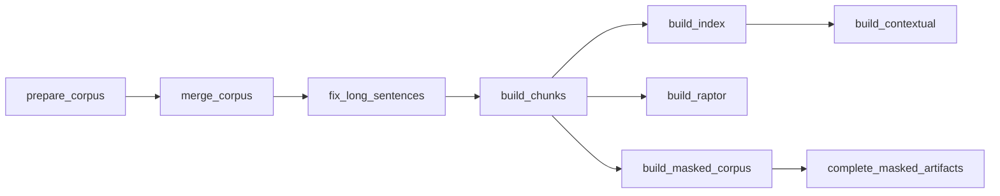

# CLI 与脚本

`src/` 是运行时；`scripts/` 是离线的数据/索引/评测工具。读源码时很容易忽略脚本，但**语料和索引都是脚本产出的**。

## CLI

[cli.py:18](../src/babyrag/cli.py#L18) 是一个 Typer app，三个命令：

| 命令 | 入口 | 做什么 |
|---|---|---|
| `babyrag info` | [cli.py:22](../src/babyrag/cli.py#L22) | 打印 9 个 rung 的计划和论文锚点 |
| `babyrag ask` | [cli.py:35](../src/babyrag/cli.py#L35) | 单题：构造 Services/LLM/graph，跑 `run_one` |
| `babyrag eval` | [cli.py:52](../src/babyrag/cli.py#L52) | 批量：`evaluate` + `summarize` + `write_reports` |

`ask` 的输出只打印 `result["hits"]` 的 `chunk_id/source/score`，不打印正文；正文在
`result["answer"]` 里。想调试检索，去 `results/*/per_query.jsonl` 看完整 hits。

## 数据管线

| 脚本 | 产物 | 说明 |
|---|---|---|
| [prepare_corpus.py](../scripts/prepare_corpus.py) | `data/corpus.jsonl` | 过滤、LLM 五主题分类、嵌套抽样 |
| [merge_corpus.py](../scripts/merge_corpus.py) | `corpus.merged.jsonl` | 把原 200 篇种子并回 1,000 篇，保住 30 题的 gold 文档 |
| [fix_long_sentences.py](../scripts/fix_long_sentences.py) | 改写 `corpus.jsonl` | 拆超长句，避免 chonkie 产出 >512 token |
| [build_chunks.py](../scripts/build_chunks.py) | `data/chunks.jsonl` + manifest | 512/64，带完整性自检 |
| [build_index.py](../scripts/build_index.py) | Chroma `chunks` | bge-m3 向量，支持 `--variant` |
| [build_contextual.py](../scripts/build_contextual.py) | `contextual.jsonl` + `contextual` 集合 | 可断点续跑，`--workers` 控制并发 |
| [build_raptor.py](../scripts/build_raptor.py) | `raptor.jsonl` + `raptor` 集合 | numpy k-means + LLM 摘要 |
| [build_masked_corpus.py](../scripts/build_masked_corpus.py) | `corpus.masked/chunks.masked` | 标题替换 + 200 篇干扰文档 |
| [complete_masked_artifacts.py](../scripts/complete_masked_artifacts.py) | masked contextual/raptor | 复用原前缀、替换标题、重新嵌入 |
| [build_public_benchmark.py](../scripts/build_public_benchmark.py) | `data/public/*` | RAGBench emanual 25 题 |

### 三个容易踩的顺序问题

1. **先 `fix_long_sentences` 再 `build_chunks`**。chonkie 的 SentenceChunker 不会硬切超长句，
   一条 3,000 字无标点会变成一个 6,000 token 的 chunk，`build_chunks` 的自检会直接中止。
2. **`merge_corpus` 不是可选的**。LLM 分类有非确定性，直接 `prepare_corpus --size 1000` 可能
   丢掉原 200 篇里的 15 篇、3 个 gold 文档；合并种子才能保证 30 题可评测。
3. **contextual 可断点续跑**。`build_contextual.py` 会读已有 `contextual.jsonl`，只补缺失的
   `chunk_id`；429/连接错误失败的项下次会重试。不要删文件重跑，会重复花钱。

## 评测管线

| 脚本 | 用途 |
|---|---|
| [run_eval.py](../scripts/run_eval.py) | 入口：`--variant`、`--rungs`、`--queries`、`--workers` |
| [recompute_metrics.py](../scripts/recompute_metrics.py) | 从已有 `per_query.jsonl` 重算指标/报告 |
| [relabel_reports.py](../scripts/relabel_reports.py) | 只重写报告的标题和说明 |
| [split_queries.py](../scripts/split_queries.py) | 分层 20 dev / 10 test |
| [evaluate_faithfulness.py](../scripts/evaluate_faithfulness.py) | 抽样 30 条，judge supported/citation |
| [calibrate_judge.py](../scripts/calibrate_judge.py) | 30 条答案的 A/B 字段对调校准 |

`run_eval.py` 在 `load_settings()` **之前**设置 `os.environ["BABYRAG_VARIANT"]`
（[run_eval.py:22](../scripts/run_eval.py#L22)），因为 `Settings` 是加载时快照。

## 改哪里

| 想改什么 | 改哪里 |
|---|---|
| 最终上下文条数 | [graph.py:232](../src/babyrag/graph.py#L232) 的 `[:5]`，以及报告里的固定假设 |
| 上下文 token 预算 | [config.py:71](../src/babyrag/config.py#L71) 的 `MAX_CONTEXT_TOKENS` |
| 新增 rung | [rungs.py:5](../src/babyrag/rungs.py#L5) + `LABELS/PAPERS`；新节点还要进 `graph.STAGES` |
| 换 embedding/rerank 模型 | [config.py:64](../src/babyrag/config.py#L64) 和 [llm.py:180](../src/babyrag/llm.py#L180) |
| 新增评测指标 | [eval.py:116](../src/babyrag/eval.py#L116) 的 `_score` + [eval.py:177](../src/babyrag/eval.py#L177) 的 `summarize` |
| 改 judge prompt | [prompts.py:60](../src/babyrag/prompts.py#L60)；同时递增 `prompt_version` 避免旧缓存 |

## Check yourself

1. 为什么 `prepare_corpus` 之后还要 `merge_corpus`？
2. `build_contextual` 中断后重跑，为什么不会重复付费？
3. 改 judge prompt 后，为什么必须改 `prompt_version`？

### Answers

1. LLM 主题分类有非确定性，1,000 篇抽样不一定包含原 200 篇；不合并会丢掉原题的 gold 文档。
2. 它先读已有 `contextual.jsonl`，按 `chunk_id` 跳过已完成项；只有缺失的才发新请求。
3. 缓存键包含 `prompt_version`；不改版本会命中旧提示词的缓存，得到旧答案。
