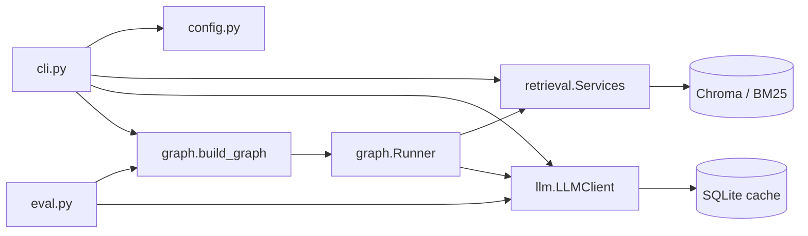

# 带你读 src

这不是 API 手册，而是**按调用链读源码**的路线。读完后你应该能回答：

- 一次 `babyrag ask` 从参数到答案经过了哪些函数？
- 为什么九个 rung 只需要一张图？
- 检索、生成、评测三层的边界在哪里？
- 改一个行为时应该动哪个文件？

## 30 秒心智模型



一句话：**`config` 提供路径和价格，`llm` 提供带缓存和计费的模型调用，
`retrieval` 提供检索器，`graph` 把节点串成一张图，`eval` 在外面跑批量并算指标。**

## 阅读顺序

| # | 文档 | 你会学到 | 主要文件 | 建议时间 |
|---|---|---|---|---|
| 1 | [一次请求的生命周期](01-request-lifecycle.md) | `ask` 的完整调用链和状态流 | `cli.py`, `graph.py` | 20 min |
| 2 | [配置与类型](02-config-types.md) | 路径、价格、`RAGState`、reducer | `config.py`, `types.py` | 15 min |
| 3 | [模型与缓存](03-llm-cache.md) | OpenCode Go session、计费、SQLite 缓存 | `llm.py`, `cache.py` | 25 min |
| 4 | [检索层](04-retrieval.md) | dense、BM25、RRF、rerank、上下文拼装 | `retrieval.py` | 30 min |
| 5 | [Rung 计划表](05-rungs.md) | 九个里程碑如何变成一行计划 | `rungs.py` | 10 min |
| 6 | [Graph 节点](06-graph.md) | plan/dispatch、grade、agentic、generate | `graph.py` | 40 min |
| 7 | [评测](07-evaluation.md) | 分母、evidence recall、Wilson、综合分 | `eval.py` | 35 min |
| 8 | [CLI 与脚本](08-cli-scripts.md) | 数据/索引管线和命令入口 | `cli.py`, `scripts/` | 25 min |
| 9 | [综合练习](09-capstone.md) | 加 rung、改 top-k、加指标、修 masked 泄漏 | 多处 | 2–4 h |

## 先跑一遍

```bash
uv sync
cp .env.example .env          # 填 OPENCODE_GO_API_KEY / SILICONFLOW_API_KEY
uv run python -m pytest -q    # 7 个纯逻辑测试，不需要网络
uv run babyrag info           # 看 9 个 rung 的计划
uv run babyrag ask "开姆尼茨工业大学的前身创办于哪一年？" --rung r2_rerank
```

如果只想读代码、不想花钱：先看 `tests/test_core.py`，它覆盖了 RRF、解析器、rung 表。

## 约定

- 代码引用写成 `[graph.py:58](../src/babyrag/graph.py#L58)`；GitHub 会跳到对应行。
- “文档说” 指 `docs/` 里的说明；“代码是” 指我实际读到的实现。
- 发现文档和代码不一致时，以代码为准，并在那一节标出来。

## Check yourself

1. 不看目录，说出 `src/babyrag/` 下五个模块各自的一句话职责。
2. 为什么 `Services` 和 `LLMClient` 不进 `RAGState`？
3. 如果只想改“最终上下文最多几条”，应该动哪个文件？

### Answers

1. `config` 路径/价格/环境；`llm` 模型调用与计费；`retrieval` 检索器；`graph` 状态机；`eval` 批量评测。`cache` 是 `llm` 的存储层。
2. 它们持有 Chroma client、SQLite 连接等不可序列化对象，放 state 会让 checkpointer 失败，也会把每次调用的状态变大。代码里由 `Services` 懒加载、`LLMClient` 在 `_env` 里按线程创建。
3. `src/babyrag/graph.py:232` 的 `hits[:5]`；预算在 `config.py:71` 的 `MAX_CONTEXT_TOKENS`。答对位置即可。
