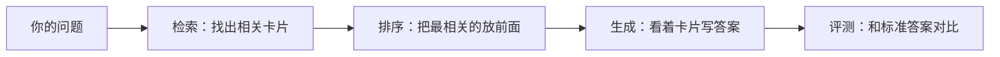

# 从零读懂 baby-rag-history

这套文档假设你**还没读过这个项目的代码**，甚至对 RAG 只有模糊印象。
它不按文件夹讲，而是跟着一个问题走完全程。你不需要记住所有细节，只要跟着故事走。

## 一句话说清这个项目

> 把 9 种“让 AI 先查资料再回答”的做法，放进**同一条流水线**，
> 用**同一套题**考试，看谁真的更好、贵多少、错在哪。

这里的“让 AI 先查资料再回答”，就是 **RAG**（Retrieval-Augmented Generation，检索增强生成）。

## 读完这套文档，你应该能

- 用自己的话解释：一个问题从输入到答案，中间经过了什么。
- 说出 9 个 rung（台阶）分别多做了什么，为什么有的反而更差。
- 看懂排行榜里的 `acc`、`evidence R@1`、`MRR`、综合分是什么意思。
- 知道想改一个行为时，应该动哪个文件。
- 不被“LangGraph”“embedding”“RRF”这些词吓住。

## 先记住三个数字

| 数字 | 含义 |
|---:|---|
| **1,000** | 中文维基文档数量（5 个主题各 200 篇） |
| **4,740** | 把文档切成的“小卡片”（chunk）数量 |
| **5** | 每次回答最多看 5 张卡片，总共不超过 4,000 token |

再加一个：**9 + 1**。9 个 rung，加一个会自己选路的 `adaptive`。

## 整条路长什么样



九个 rung 的差别，全在**检索和排序**这一段。生成和评分对所有人都一样。

## 怎么读

按顺序读，每篇 10–20 分钟。不要一上来抠代码，先看故事和比喻；每篇最后有“想深入看代码”的链接。

| 篇 | 标题 | 读完你会知道 |
|---|---|---|
| 1 | [一个问题的旅程](01-a-question-journey.md) | 一次提问从头到尾发生了什么 |
| 2 | [数据与索引](02-data-and-index.md) | 语料怎么变成可检索的卡片 |
| 3 | [检索的四种武器](03-retrieval.md) | 语义、关键词、投票、精排各自干什么 |
| 4 | [九个台阶与一张图](04-rungs-and-graph.md) | 9 个 rung 如何共用一张流水线 |
| 5 | [模型调用与省钱](05-llm-and-cost.md) | 为什么缓存能省下大部分钱 |
| 6 | [怎么证明它有效](06-evaluation.md) | 排行榜的数字到底怎么来的 |
| 7 | [动手改代码](07-change-the-code.md) | 想改行为时从哪里下手 |

想直接读代码？走 [`code-walkthrough/`](code-walkthrough/README.md)：按函数贴真实代码、
逐行解释、标调用关系和坑。

## 读之前，先做一件事

如果你愿意，先跑一遍：

```bash
uv run babyrag info
```

它会打印 9 个 rung 的名字和步骤。看不懂没关系，读完第 4 篇再回来看，你会一眼认出每一行。

## 最后一句

> 这个项目不是“造一个最强 RAG”，而是**造一把尺子**：
> 同一份资料、同一批题、同一个预算，量出每种做法的真实代价。

## 检查一下

**问：** 这个项目里，9 个 rung 主要在哪一段不同？

**答：** 检索和排序。生成用的模型、提示词、上下文预算对所有 rung 都一样，所以差别能被归因到检索链路。
