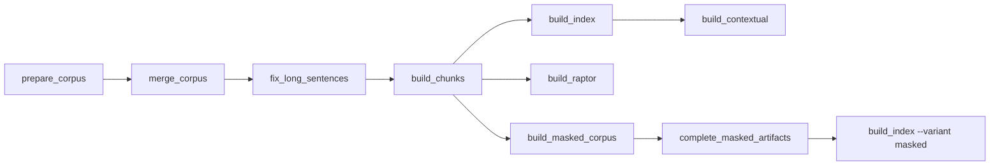

# 代码漫游 07 · CLI 与脚本

`src/` 是运行时；`scripts/` 是离线工具。这一篇读入口和管线，不逐行抠每个脚本的清洗正则。

## 1. CLI

[`cli.py:18`](../../src/babyrag/cli.py#L18) 是一个 Typer app。

### `info`

[`cli.py:23`](../../src/babyrag/cli.py#L23)：

```python
for rung in ALL_RUNGS:
    plan = "adaptive" if rung == "adaptive" else " → ".join(RUNGS[rung])
    table.add_row(rung, LABELS.get(rung, ""), plan, PAPERS.get(rung, ""))
```

只读常量，不发请求。

### `ask`

[`cli.py:36`](../../src/babyrag/cli.py#L36)：

```python
settings = load_settings()
services = Services(settings)
llm = LLMClient(settings)
graph = build_graph(services, llm)
result = run_one(graph, question=question, rung=rung, mode=mode)
```

就是 [`learn/01`](../01-a-question-journey.md) 那条链。

### `eval`

[`cli.py:53`](../../src/babyrag/cli.py#L53)：

```python
rows = evaluate(settings, rungs=chosen, limit=limit, workers=workers)
summary = summarize(rows)
write_reports(rows, summary)
```

CLI 的 `eval` 没有 `--queries/--variant` 参数；需要这些时用 `scripts/run_eval.py`。

## 2. 数据管线



`merge_corpus` 是可选的：日常全量重建可以跳过；要保留 30 题的 gold 文档时必须跑。

### 2.1 `prepare_corpus.py`

[`scripts/prepare_corpus.py`](../../scripts/prepare_corpus.py) 的 `main`：

- 读 parquet（`iter_rows`）；
- `reject_reason` 过滤长度/语言/标题；
- 分类（LLM 或 rule）；
- 嵌套抽样：`rank = blake2b(seed:title)`，按主题交错；
- 写 `data/corpus.jsonl` + manifest。

关键抽样代码（简化）：

```python
for theme in picked:
    picked[theme].sort(key=lambda row: row["rank"])
ordered = []
for i in range(pool_size):
    for theme in THEMES:
        if i < len(picked.get(theme, [])):
            ordered.append(picked[theme][i])
docs = ordered[: args.size]
```

**坑**：LLM 分类模式有非确定性；同样的 `--size 1000` 两次跑，选出的 1,000 篇可能不完全一样。
`--classifier rule` 则是纯规则，结果可复现。

### 2.2 `merge_corpus.py`

把原 200 篇种子并回新语料，按标题去重，保证 30 题的 gold 文档不丢。
`prepare_corpus` 默认写 `data/corpus.jsonl`，而 `merge_corpus` 默认读
`data/corpus.base.jsonl` 和 `data/corpus.rule.jsonl`；merge 前要把两份输入放好，
或用 `--seed` / `--extra` 显式指定。

```python
seen = {norm_title(d["title"]) for d in seed}
merged = list(seed)
for doc in extra:
    key = norm_title(doc["title"])
    if not key or key in seen:
        continue
    seen.add(key)
    merged.append(doc)
    if len(merged) >= args.size:
        break
```

### 2.3 `fix_long_sentences.py`

chonkie 的 SentenceChunker 不会硬切超长句。这个脚本在标点处把 >400 token 的句子拆开，
否则 `build_chunks` 会因 oversize chunk 中止。

### 2.4 `build_chunks.py`

[`scripts/build_chunks.py`](../../scripts/build_chunks.py)：

```python
chunker = DocumentChunker(
    chunk_size=params.CHUNK_SIZE,
    chunk_overlap=params.CHUNK_OVERLAP,
    encoding=params.ENCODING,
    delim=params.DELIM,
    include_delim=params.INCLUDE_DELIM,
)
rows = chunk_corpus(docs, chunker)
problems = find_problems(rows, docs)
if problems:
    ...
    return 1
```

`find_problems` 检查：每篇至少有一个 chunk、首块从 0 开始、末块到文末、seq 连续、
offset 与原文一致、没有 oversize、没有重复 chunk id / doc id、相邻块之间没有 gap 或倒序。

## 3. 索引脚本

### 3.1 `build_index.py`

```python
rows = read_jsonl(__import__("pathlib").Path(args.chunks or paths["chunks"]))
store = Chroma(collection_name=args.collection or paths["dense"], ...)
for start in range(0, len(rows), args.batch):
    batch = rows[start:start + args.batch]
    docs = [Document(page_content=r["text"], metadata={
        "chunk_id": r["chunk_id"], "doc_id": r["doc_id"],
        "title": r.get("title", ""), "theme": r.get("theme", ""),
        "level": 0,
    }) for r in batch]
    store.add_documents(docs, ids=[r["chunk_id"] for r in batch])
```

建之前会先数 `store._collection.count()`：数量已经等于 `len(rows)` 就直接跳过，
既不为 0 又不等于目标数量就报错并提示 `--rebuild`，避免悄悄写进半套索引。

`--variant` 决定路径和 collection；`--rebuild` 先删 collection。这里的
`__import__("pathlib").Path` 只是脚本作者少写一个顶层 `import`，等价于正常导入。

### 3.2 `build_contextual.py`

```python
todo = [r for r in rows if r["chunk_id"] not in existing]
with ThreadPoolExecutor(max_workers=args.workers) as pool:
    futures = {pool.submit(make_prefix, r, docs.get(r["doc_id"], ""), masked=masked): r
               for r in todo}
```

- **可断点续跑**：先读已有 `contextual.jsonl`，按 `chunk_id` 跳过。
- 429/连接错误先在 `LLMClient` 里重试；最终仍失败时脚本打印该 chunk 并继续，不会中止整批，下次重跑补上。
- `--index` 才会顺便重建 Chroma collection。

### 3.3 `build_raptor.py`

- 用 bge-m3 给所有叶子算向量；
- numpy k-means 聚类（每簇约 9 个）；
- LLM 摘要成一级节点；再对一级节点聚类、摘要成二级；
- 写 `raptor.jsonl`，建 `raptor` collection。

摘要 prompt 要求保留实体名、地点、年份、数字；否则摘要会丢事实。

## 4. masked 与公开集

### 4.1 `build_masked_corpus.py`

```python
masked = dict(chunk)
masked["text"] = mask_text(chunk["text"], chunk["title"])
```

docs 和 chunks 的 `text` 都做了替换，但 **chunk 的 `title` 字段仍是原文**。
拼上下文时 `build_context` 会把 metadata 的 `title` 当前缀拼回去，所以这是部分去偏，
不是把标题从所有表示里彻底删掉。

### 4.2 `complete_masked_artifacts.py`

```python
if cid in original_contextual:
    prefix = strip_title(original_contextual[cid].get("prefix", ""), [title])
else:
    prefix = ""
rows.append({"chunk_id": cid, ..., "contextual_text": f"{prefix}\n{chunk['text']}"})
```

复用原 contextual 前缀，把标题替换成「（标题已隐藏）」，再重新嵌入。
这样省掉了为 base chunks 重跑一遍 contextual（约 4,700 次 LLM，脚本注释估 ~45 分钟 / ~$1.4），
但前缀语义可能仍带原标题痕迹；新增的 `neg-*` chunks 没有原前缀，只能为空。

### 4.3 `build_public_benchmark.py`

从 RAGBench `emanual` 取 25 题，文档去重、切分，写 `data/public/*`。
`queries.jsonl` 的 `gold_doc_ids` 来自 `sentence_support_information` 的 supporting keys。

公开锚点固定 **25 题**：`build_public_benchmark.py` 的 `COUNT = 25`
（[`build_public_benchmark.py:23`](../../scripts/build_public_benchmark.py#L23)），
`run_eval.py` 的 public 报告说明和 `data/public/manifest.json` 也按 25 题。

## 5. 评测脚本

### 5.1 `run_eval.py`

```python
os.environ["BABYRAG_VARIANT"] = args.variant
os.environ["BABYRAG_LLM_PROVIDER"] = args.provider
if args.model:
    os.environ["BABYRAG_LLM_MODEL"] = args.model
...
settings = load_settings()
rows = evaluate(settings, rungs=chosen, limit=args.limit, workers=args.workers,
                queries_path=queries_path, run_name=run_name)
```

**顺序很重要**：先设环境变量，再 `load_settings()`；`Settings` 是加载时快照。
`--provider siliconflow` 会同时切换 API key、base URL、模型和计费方式（见 01 / 02）。

### 5.2 其他脚本

| 脚本 | 用途 |
|---|---|
| `recompute_metrics.py` | 从已有 `per_query.jsonl` 重算指标/报告 |
| `relabel_reports.py` | 只重写报告标题和说明 |
| `split_queries.py` | 分层 20 dev / 10 test |
| `evaluate_faithfulness.py` | 抽样 30 条，judge supported/citation |
| `calibrate_judge.py` | 30 条答案 A/B 字段对调 |
| `render_graph.py` | 生成 `docs/graph.png/html/mmd` |

## 调用关系

```text
prepare_corpus -> merge_corpus -> fix_long_sentences -> build_chunks
build_chunks -> build_index -> build_contextual
build_chunks -> build_raptor
build_chunks -> build_masked_corpus -> complete_masked_artifacts -> build_index --variant masked
run_eval -> evaluate -> run_one -> judge -> write_reports
```

`build_index --variant masked` 这一步不能省：`complete_masked_artifacts` 只重建 contextual 和
RAPTOR 两个 collection，base dense collection 要单独建。

## 坑清单

| 坑 | 位置 | 后果 |
|---|---|---|
| 先 load_settings 再设 variant | run_eval.py:25 | 用了 original |
| 不 merge 种子 | merge_corpus.py | 30 题里 3 个 gold 文档丢失 |
| 不修长句 | fix_long_sentences.py | build_chunks 中止 |
| 删 contextual.jsonl 重跑 | build_contextual.py | 重复付费 |
| 以为 masked 完全去标题 | build_masked_corpus.py | 上下文仍有 title |

## 自测

1. 为什么 `run_eval.py` 要在 `load_settings()` 之前设置环境变量？
2. `build_contextual.py` 中断后重跑，为什么不会重复付费？
3. `build_masked_corpus.py` 改了正文标题，为什么上下文里还能看到标题？

### 答案

1. `Settings` 在加载时读取 `BABYRAG_VARIANT` 并缓存；之后再改环境变量不会影响已构造的 Settings。
2. 它先读已有 `contextual.jsonl`，按 `chunk_id` 跳过已完成项，只补缺失。
3. `build_context` 会用 metadata 的 `title` 作为前缀；masked 只替换了 chunk 正文，没有改 metadata 的 title。
