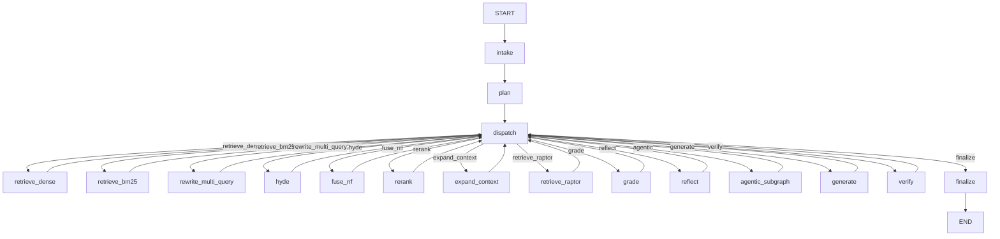

# baby-rag-history 技术设计说明（LangGraph 单图多里程碑）

> 目标：在 **一个** LangGraph 状态机里演示 RAG 的 6+ 个历史里程碑；既能固定某一"台阶"做可复现评测（ladder），也能按问题自适应路由（adaptive）；总 LLM 预算 $10，所有可缓存产物必须缓存。
>
> 版本基准：LangGraph 1.2.x（当前 PyPI 为 1.2.24）、langchain-core 1.4.x、Python 3.12、uv。
> 文中标注「待验证」的条目见第 11 节。

---

## 0. TL;DR：关键决策

1. **一张图 + 计划驱动**：`plan` 节点把"本次要跑哪些阶段"算成一个有序计划 `plan: list[Stage]`，然后由一个 `dispatch` 节点循环派发；每个阶段只做一件事，做完 `cursor += 1` 回到 `dispatch`。
   - `mode="ladder"`：计划由"台阶表"（rung table）静态查表得到。
   - `mode="adaptive"`：计划由路由节点根据问题特征 + 预算动态生成（可先规则后 LLM）。
2. **不做 N 个策略子图**。里程碑是"能力阶段"的组合，不是 N 套重复图。唯一需要子图的是 **Agentic ReAct**（它有自己的消息循环和工具调用），其余阶段扁平化。
3. 状态里只放**可序列化的数据**；模型、Chroma client、BM25 索引、reranker client 放 `Runtime.context` 或模块级单例，避免 checkpointer 序列化失败。
4. **缓存下沉到 LLM/工具调用层**（SQLite KV），键为 `(stage, prompt_version, model, 规范化输入哈希)`；不要只依赖 LangGraph 的 `CachePolicy`（它按节点输入 pickle 哈希，跨进程/细粒度复用不如自建缓存）。
5. **成本与延迟按节点记录**：统一 `LLMClient` 包装器读取 `AIMessage.usage_metadata`，每个节点退出时写一条 `NodeRecord` 到 state，同时立刻落 SQLite；这样预算守卫和断点续跑都可靠。
6. 评测：150 题 × 8 个 rung，主指标 `evidence_recall@gold_doc`、`answer_correct`(LLM judge)、`abstain_accuracy`、`p95 latency`、`$/query`；产出 `per_query.jsonl + summary.json + report.md`。

---

## 1. 推荐的 LangGraph 架构

### 1.1 图形态



说明：

- `plan` 只产出计划，不做事；`dispatch` 是唯一的路由点（一个纯函数，返回下一个节点名），因此"为什么走这一步"只需看 `state["plan"]`、`state["cursor"]`、`state["route_reason"]`。
- 每个阶段节点只返回**部分状态**，并且统一 `cursor = state["cursor"] + 1`。绝不在节点里原地修改 `state` 的 list（LangGraph 用 reducer 合并，原地修改会导致重复累加）。
- 不建议在同一个节点上同时用静态边和 `Command(goto=...)`（官方明确警告会两条路都跑）。本设计统一用 **conditional edge** 做派发；如果更喜欢 `Command`，让所有阶段节点 `return Command(goto="dispatch", update=...)`，但不要给这些节点再 `add_edge`。
- `agentic` 节点挂一个编译好的 ReAct 子图（`builder.add_node("agentic", react_subgraph)`），子图内部用 `MessagesState` + 工具循环，父图只关心它返回的 `chunks/answer/usage`。

### 1.2 State schema

```python
from __future__ import annotations

import operator
from typing import Annotated, Any, Literal, TypedDict


class Chunk(TypedDict, total=False):
    chunk_id: str          # 稳定主键：f"{doc_id}#{ordinal}"
    doc_id: str
    title: str
    text: str
    score: float
    rank: int              # 1-based
    source: str            # dense | bm25 | hyde | multiquery | raptor | rerank | agentic
    level: int             # RAPTOR 层级；普通 chunk 为 0
    meta: dict[str, Any]


class RetrievalRound(TypedDict, total=False):
    stage: str
    query: str
    k: int
    chunk_ids: list[str]
    scores: list[float]
    latency_ms: int


class Grade(TypedDict, total=False):
    chunk_id: str
    relevant: bool
    score: int             # 0/1/2
    reason: str
    rubric_version: str


class NodeRecord(TypedDict, total=False):
    node: str
    stage: str
    started_at: str        # ISO8601 UTC
    latency_ms: int
    llm_calls: int
    tokens_in: int
    tokens_out: int
    cost_usd: float
    cache_hits: int
    cache_misses: int
    model: str | None
    estimated: bool        # usage 缺失时为 True
    extra: dict[str, Any]


class Usage(TypedDict, total=False):
    tokens_in: int
    tokens_out: int
    llm_calls: int
    cost_usd: float
    cache_hits: int
    cache_misses: int


def add_usage(left: Usage, right: Usage) -> Usage:
    keys = ("tokens_in", "tokens_out", "llm_calls", "cost_usd", "cache_hits", "cache_misses")
    return {k: left.get(k, 0) + right.get(k, 0) for k in keys}


class RAGState(TypedDict, total=False):
    # ---- 输入（评测时带 gold，生产时可省略） ----
    qid: str
    question: str
    qtype: str
    theme: str
    gold_answer: str
    gold_doc_ids: list[str]
    evidence: list[str]
    should_abstain: bool

    # ---- 控制面 ----
    mode: Literal["ladder", "adaptive"]
    rung: str                    # ladder 模式固定；adaptive 记录最终选的 rung
    plan: list[str]              # 有序阶段名，元素必须是已注册节点
    cursor: int
    prompt_version: str
    budget_usd: float
    max_retries: int
    route_reason: str

    # ---- 查询理解 ----
    normalized_query: str
    query_variants: list[str]
    hyde_doc: str
    sub_questions: list[str]

    # ---- 检索（last-write-wins） ----
    chunks: list[Chunk]
    context_text: str
    citations: list[str]

    # ---- 多轮/反思 ----
    retrieval_log: Annotated[list[RetrievalRound], operator.add]
    grades: list[Grade]
    reflections: list[str]
    retries: int

    # ---- 输出 ----
    answer: str
    abstained: bool
    abstain_reason: str
    confidence: float

    # ---- 遥测（reducer 累加） ----
    records: Annotated[list[NodeRecord], operator.add]
    usage: Annotated[Usage, add_usage]
    errors: Annotated[list[str], operator.add]
```

设计要点：

- **`chunks` 用 last-write-wins，不用 `operator.add`。** 检索阶段"替换当前候选集"，历史放 `retrieval_log`。这是最常见的状态 bug：给 `chunks` 加 `operator.add` 后，每轮都重复追加同一批 chunk，RRF 分数被污染。
- `total=False` 让节点可以只返回自己写的字段；但 `usage` 必须由输入初始化（`{"usage": {}}`），否则首次 reducer 的 left 缺失（LangGraph 对缺失通道通常能处理，但显式初始化最稳）。
- 嵌套值用 `TypedDict`/dataclass，不用 Pydantic 模型当状态（官方推荐 TypedDict 性能更好；`create_agent` 更是只接受 TypedDict）。
- **不要把 Chroma client、BM25 索引、`ChatOpenAI` 实例放进 state**。checkpointer 默认 `JsonPlusSerializer` 不能可靠序列化它们；用 `Runtime.context` 或进程级单例。

### 1.3 节点清单（与职责）

| 节点 | 类型 | 主要职责 | 是否调 LLM |
|---|---|---|---|
| `intake` | 同步 | 规范化问题、读取 qid/type、初始化 usage、设置预算 | 否 |
| `plan` | 同步 | ladder 查表 / adaptive 选 rung，生成 `plan`、`route_reason` | adaptive 可选 1 次 |
| `dispatch` | 同步 | 按 `cursor` 返回下一个节点名；越界则 `finalize` | 否 |
| `rewrite_multi_query` | 异步 | 生成 3 个查询变体（RAG-Fusion） | 是（缓存） |
| `hyde` | 异步 | 生成假设性答案文档 | 是（缓存） |
| `retrieve_dense` | 同步/线程 | bge-m3 + Chroma，top_k | 否（embedding API） |
| `retrieve_bm25` | 同步/线程 | jieba + bm25s，top_k | 否 |
| `fuse_rrf` | 同步 | RRF 融合（k=60），去重、截断 | 否 |
| `rerank` | 异步 | SiliconFlow `/v1/rerank`，top_n | 否（rerank API） |
| `expand_context` | 同步 | 上下文检索：拼接文档标题/章节/上下文前缀；可选句窗扩展 | 否 |
| `retrieve_raptor` | 同步 | 在 chunk 集合 + 摘要集合上做 collapsed-tree 检索 | 否 |
| `grade` | 异步 | CRAG 相关性打分（批量一次调用） | 是（缓存） |
| `reflect` | 异步 | 根据 grade 结果改写查询，准备重试 | 是（缓存） |
| `agentic` | 子图 | ReAct 多步检索（工具：dense/bm25/fetch_doc） | 是（多步） |
| `generate` | 异步 | 基于 context 生成答案 + 引用 | 是 |
| `verify` | 异步 | 可选：答案-证据一致性检查；不通过则降级为 abstain | 是（缓存） |
| `finalize` | 同步 | 汇总 usage/cost，写 run 记录，输出 | 否 |
| `abstain` | 同步 | 证据不足时给出"无法回答"+原因 | 否 |

阶段粒度建议：

- `retrieve_dense` + `retrieve_bm25` 如果都要跑，**不要做成两个串行节点**（平白多 1 个 super-step + 1 次往返）。给 ladder 提供一个 `retrieve_hybrid` 节点，内部 `asyncio.gather` 并发跑两路，`retrieval_log` 里分别记两条。图上的节点数应服务于"可观测/可重试边界"，不是越细越好。
- `grade` 要一次批量评 5~8 个 chunk（结构化输出一个数组），不要每 chunk 一次调用；否则每题 8 次调用，预算直接爆。

### 1.4 条件边与循环

```python
def dispatch(state: RAGState) -> str:
    plan = state.get("plan") or []
    i = state.get("cursor", 0)
    if i >= len(plan):
        return "finalize"
    return plan[i]


builder.add_edge(START, "intake")
builder.add_edge("intake", "plan")
builder.add_edge("plan", "dispatch")

# 键必须覆盖 RUNGS 里出现的全部阶段名 + finalize。
STAGE_TARGETS = {
    "rewrite_multi_query": "rewrite_multi_query",
    "hyde": "hyde",
    "retrieve_dense": "retrieve_dense",
    "retrieve_dense_multi": "retrieve_dense_multi",
    "retrieve_hybrid": "retrieve_hybrid",
    "retrieve_raptor": "retrieve_raptor",
    "fuse_rrf": "fuse_rrf",
    "rerank": "rerank",
    "expand_context": "expand_context",
    "grade": "grade",
    "reflect": "reflect",
    "agentic": "agentic",
    "generate": "generate",
    "verify": "verify",
    "abstain": "abstain",
    "finalize": "finalize",
}
builder.add_conditional_edges("dispatch", dispatch, STAGE_TARGETS)

for stage in STAGE_TARGETS:
    if stage not in {"finalize"}:
        builder.add_edge(stage, "dispatch")
builder.add_edge("finalize", END)
```

递归上限：默认 10,007（LangGraph ≥1.1.4），10 个阶段约 22 个 super-step，远不会触发；但评测时仍建议显式 `recursion_limit=64`，把"计划写错导致死循环"变成快速失败，而不是烧钱跑一万步。

### 1.5 子图：只给 Agentic ReAct

```python
class ReactState(TypedDict, total=False):
    messages: Annotated[list[AnyMessage], add_messages]
    chunks: list[Chunk]
    steps: int
    max_steps: int


def build_react_subgraph(tools, llm):
    b = StateGraph(ReactState)
    b.add_node("agent", agent_node)        # llm.bind_tools(tools)
    b.add_node("tools", ToolNode(tools))
    b.add_edge(START, "agent")
    b.add_conditional_edges("agent", should_continue, {"tools": "tools", "done": END})
    b.add_edge("tools", "agent")
    return b.compile()   # 子图不需要独立 checkpointer；由父图统一持久化
```

父图把它当普通节点：`builder.add_node("agentic", react_subgraph)`。注意：

- 子图有自己的 state，父图只拿它返回的字段（用 `Command`/输出映射，或在包装节点里调用 `subgraph.invoke` 后转成父 state）。
- 若希望父图 token 流里看到子图 LLM token，需要 `subgraph=True`（v2 用 `part["ns"]` 判断）。
- 子图节点名不要和父图重名；调试时看 `ns` 命名空间。

### 1.6 持久化 / checkpointing

```python
import sqlite3
from langgraph.checkpoint.sqlite import SqliteSaver

conn = sqlite3.connect("data/checkpoints.sqlite", check_same_thread=False)
checkpointer = SqliteSaver(conn)
graph = builder.compile(checkpointer=checkpointer)
```

异步路径用 `AsyncSqliteSaver`（需要 `aiosqlite`）：

```python
from langgraph.checkpoint.sqlite.aio import AsyncSqliteSaver

async with AsyncSqliteSaver.from_conn_string("data/checkpoints.sqlite") as cp:
    graph = builder.compile(checkpointer=cp)
    await graph.ainvoke(inputs, config)
```

建议：

- `thread_id = f"{run_id}:{qid}:{rung}"`。评测时每个 (题, rung) 一个 thread，支持单题重跑与 time travel。
- 评测基准测试用 `durability="exit"`（只在结束时落盘），避免每个 super-step 同步写 SQLite 把 p95 拉高；调试/交互用 `"sync"`。
- checkpointer 里存完整 state 会随 `records`/`retrieval_log` 增长；评测 150 题没问题，但长期跑要定期清理 checkpoint（或只保留最近 N 个 thread）。
- **断点续跑**：进程崩了用 `graph.invoke(None, config)` 从最后一个 checkpoint 继续；因为所有 LLM 调用另有 SQLite 缓存，重跑代价接近 0。

### 1.7 流式输出

CLI 用：

```python
async for part in graph.astream(
    inputs,
    config={"configurable": {"thread_id": thread_id}, "recursion_limit": 64},
    stream_mode=["updates", "custom"],
    version="v2",
):
    if part["type"] == "updates":
        for node, update in part["data"].items():
            ui.node_done(node, update)
    elif part["type"] == "custom":
        ui.progress(part["data"])
```

- 节点里用 `get_stream_writer()` 发进度：`writer({"node": "rerank", "msg": "重排 50 → 8"})`。
- 只有最终答案需要逐 token 时，再加 `stream_mode="messages"`，并用 `metadata["langgraph_node"] == "generate"` 过滤；评测用 `ainvoke`，不要为了流式牺牲吞吐。
- v1/v2 输出格式不同：`version="v2"` 统一为 `{type, ns, data}`（LangGraph ≥1.1）。新代码建议直接 v2；老示例里的 `(mode, chunk)` 元组是 v1 行为。
- `astream` 只有在节点是 async（或底层 LLM 走 `ainvoke/astream`）时才有真正的并发/流式收益；在 async 节点里调用同步 `invoke` 会阻塞事件循环。

### 1.8 每节点成本/延迟记录

#### 数据流

```
LLMClient.invoke()
  └─ 计时 → 查缓存 → 调 API → 读 usage_metadata → 算 USD → recorder.add()
节点包装器
  └─ 进入时 set_current_recorder()；退出时 record = recorder.snapshot()
     return {"records": [record], "usage": record_to_usage(record), ...}
finalize
  └─ 聚合 state["usage"]，写 SQLite runs 表 + JSONL
```

#### 记录器实现要点

```python
import contextvars
import time
from dataclasses import dataclass, field

_current: contextvars.ContextVar["CallRecorder | None"] = contextvars.ContextVar(
    "call_recorder", default=None
)


@dataclass
class CallRecorder:
    node: str
    stage: str
    model: str | None = None
    tokens_in: int = 0
    tokens_out: int = 0
    llm_calls: int = 0
    cache_hits: int = 0
    cache_misses: int = 0
    cost_usd: float = 0.0
    estimated: bool = False
    extra: dict = field(default_factory=dict)

    def add_llm(self, *, model: str, tin: int, tout: int, cached_in: int = 0,
                cache_hit: bool = False, estimated: bool = False) -> None:
        self.model = model
        self.llm_calls += 1
        self.tokens_in += tin
        self.tokens_out += tout
        self.cost_usd += cost_usd(model, tin, tout, cached_in)
        self.estimated |= estimated
        if cache_hit:
            self.cache_hits += 1
        else:
            self.cache_misses += 1


@contextlib.contextmanager
def instrument(node: str, stage: str | None = None):
    rec = CallRecorder(node=node, stage=stage or node)
    token = _current.set(rec)
    t0 = time.perf_counter()
    try:
        yield rec
    finally:
        _current.reset(token)
        rec.extra["latency_ms"] = int((time.perf_counter() - t0) * 1000)
```

包装一个图节点：

```python
def node_generate(state: RAGState) -> dict:
    with instrument("generate") as rec:
        out = _generate_impl(state, rec)
    return {
        **out,
        "cursor": state["cursor"] + 1,
        "records": [{
            "node": "generate",
            "stage": "generate",
            "latency_ms": rec.extra["latency_ms"],
            "llm_calls": rec.llm_calls,
            "tokens_in": rec.tokens_in,
            "tokens_out": rec.tokens_out,
            "cost_usd": round(rec.cost_usd, 6),
            "cache_hits": rec.cache_hits,
            "cache_misses": rec.cache_misses,
            "model": rec.model,
            "estimated": rec.estimated,
        }],
        "usage": {
            "tokens_in": rec.tokens_in,
            "tokens_out": rec.tokens_out,
            "llm_calls": rec.llm_calls,
            "cost_usd": rec.cost_usd,
            "cache_hits": rec.cache_hits,
            "cache_misses": rec.cache_misses,
        },
    }
```

**为什么用 contextvar 而不是把 recorder 塞进 state**：state 要序列化，recorder 是可变对象；contextvar 在 async 任务中会自动复制上下文。但注意：`asyncio.to_thread` / `ThreadPoolExecutor` **不会**自动传播 contextvar（Python 3.12 的 `asyncio.to_thread` 会复制 context，但裸 `run_in_executor` 不会），在检索线程里要显式把 recorder 传进去，或只在线程外记账。

**回调兜底**：再挂一个 `BaseCallbackHandler.on_llm_end`，读取 `response.llm_output.get("token_usage")` 或 `response.generations[0][0].message.usage_metadata`。当某个第三方封装绕过 `LLMClient` 时，用回调补记，并在 `record.extra["source"]="callback"` 标记。不要同时双记，先以 `LLMClient` 为准。

---

## 2. "6+ 里程碑"如何优雅建模

### 2.1 结论

**推荐"能力阶段库 + 计划驱动"**，而不是"每个里程碑一个子图"：

- 里程碑本质是**阶段集合的差**：R1 = R0 + BM25 + RRF；R2 = R1 + rerank；R5 = R2 + contextual；…… 用子图表达会产生大量重复节点和重复 prompt，修一个 bug 要改 N 处。
- ladder 模式只是"计划表的一行"；adaptive 模式只是"运行时生成同一张表的另一行"。**评测与线上走完全相同的节点代码**，消掉"评测用 A 实现、上线用 B 实现"的偏差。
- 新增第 9 个里程碑 = 加一个节点 + 在表里加一行，不动图拓扑。
- 代价：图不如静态拓扑直观。用 `get_graph()` 的 Mermaid 输出 + `plan` 日志补偿；ladder 评测时可以把计划打印出来作为"这次到底跑了什么"的证据。

### 2.2 台阶表（建议 8 级，覆盖 6+ 里程碑）

| rung | 里程碑 | 计划（plan） | 新增能力 | 额外 LLM/题 | 主要缓存 |
|---|---|---|---|---|---|
| `r0_dense` | Naive RAG | `retrieve_dense → generate` | bge-m3 + Chroma top-k | 1 | 无（embedding 缓存） |
| `r1_hybrid` | Hybrid + RRF | `retrieve_hybrid → fuse_rrf → generate` | BM25(jieba) + dense，RRF k=60 | 1 | 无 |
| `r2_rerank` | Rerank | `retrieve_hybrid → fuse_rrf → rerank → generate` | bge-reranker-v2-m3 | 1 | rerank 结果 |
| `r3_hyde` | HyDE | `hyde → retrieve_hybrid → fuse_rrf → rerank → generate` | 假设文档向量检索（叠加在 r2 上） | 2 | HyDE 文本 |
| `r4_multiquery` | Multi-query / RAG-Fusion | `rewrite_multi_query → retrieve_dense_multi → fuse_rrf → rerank → generate` | 3 个查询变体 + RRF | 2 | 变体文本 |
| `r5_contextual` | Contextual Retrieval | `retrieve_hybrid → fuse_rrf → rerank → expand_context → generate` | chunk 前缀（文档标题/章节/上下文句） | 1（离线摊薄） | 每 chunk 前缀 |
| `r6_raptor` | RAPTOR 摘要树 | `retrieve_raptor → rerank → generate` | 聚类摘要层 + collapsed tree | 1（离线摊薄） | 摘要 + 聚类 |
| `r7_crag` | CRAG 自反思 + 弃答 | `retrieve_hybrid → fuse_rrf → rerank → grade → (reflect→retrieve)* → generate/abstain` | 相关性评分、重试上限 2、弃答 | 3~5 | grade verdict |
| `r8_agentic` | Agentic ReAct | `agentic → verify → generate` | 多步工具检索、查询分解 | 4~8 | 工具结果 + 中间结论 |
| `r9_adaptive` | 自适应路由 | 运行时决定上述之一 | 规则/分类器 + 预算守门 | 0~1 | 路由决策 |

实现上建议：

```python
RUNGS: dict[str, list[str]] = {
    "r0_dense":       ["retrieve_dense", "generate"],
    "r1_hybrid":      ["retrieve_hybrid", "fuse_rrf", "generate"],
    "r2_rerank":      ["retrieve_hybrid", "fuse_rrf", "rerank", "generate"],
    "r3_hyde":        ["hyde", "retrieve_hybrid", "fuse_rrf", "rerank", "generate"],
    "r4_multiquery":  ["rewrite_multi_query", "retrieve_dense_multi", "fuse_rrf", "rerank", "generate"],
    "r5_contextual":  ["retrieve_hybrid", "fuse_rrf", "rerank", "expand_context", "generate"],
    "r6_raptor":      ["retrieve_raptor", "rerank", "generate"],
    "r7_crag":        ["retrieve_hybrid", "fuse_rrf", "rerank", "grade", "generate"],
    "r8_agentic":     ["agentic", "verify", "generate"],
}
```

注意 `r7_crag` 的 `reflect → retrieve` 是**循环**：不要把它写进 `plan`（会无限增长），而是让 `grade` 节点在 `retries < max_retries` 时返回 `plan` 插入 `["reflect", "retrieve_hybrid", "fuse_rrf", "grade"]`，否则继续 `generate`。或者更简单：`grade` 节点内部完成"评分 → 若不足则改写查询并再检索一次"（一次节点内循环），只把最终结果写回 state。**后者更省 super-step、更好控成本**，推荐后者；只有当你想在 UI 上看到"反思"这一步时才拆节点。

### 2.3 ladder 模式

```python
def plan_node(state: RAGState) -> dict:
    if state["mode"] == "ladder":
        rung = state["rung"]
        return {"plan": RUNGS[rung], "cursor": 0, "route_reason": f"ladder:{rung}"}
    ...
```

用途：

- 评测每个 rung 的固定能力上限；
- 回归测试（同一 rung 的输出应稳定，缓存命中下逐字节可复现）；
- 消融（r2 vs r1 的差值 = rerank 的贡献）。

### 2.4 adaptive 模式

先规则、后 LLM，且 LLM 分类结果必须缓存：

```python
def choose_rung(q: str, qtype: str, budget_ok: bool, dense_top1: float | None) -> tuple[str, str]:
    if qtype in {"multi_hop", "comparison"}:
        return "r8_agentic", "type=multi_hop"
    if qtype == "negation" or qtype == "unanswerable":
        return "r7_crag", "type=unanswerable"
    if dense_top1 is not None and dense_top1 < 0.35:
        return "r3_hyde", "low_dense_score"
    if len(q) > 60:
        return "r4_multiquery", "long_query"
    return "r1_hybrid", "default"
```

更稳的做法是**两段式**：

1. 用 r0/r1 先跑一次便宜检索，拿到 `dense_top1` / BM25 命中数等特征（已缓存，几乎免费）；
2. 规则决定是否升级到 r2/r7；只有规则不确定时才调一次分类 LLM（temperature=0，输出 JSON，缓存）。

评测 adaptive 时额外报告：

- `routing_distribution`：各 rung 被选中的比例；
- `oracle_best_rung` 与 `regret = metric(oracle) - metric(chosen)`：衡量路由器的上限差距；
- `cost_per_correct`：每答对一题花多少钱（比单纯 $/query 更能说明问题）。

---

## 3. 节点职责与 `src/` 布局

```
baby-rag-history/
├── pyproject.toml
├── uv.lock
├── .env.example
├── data/
│   ├── corpus/wiki_200.jsonl          # doc_id, title, text, url
│   ├── chunks/chunks_869.jsonl        # chunk_id, doc_id, ordinal, text, n_tokens
│   ├── index/chroma/                  # Chroma persistent
│   ├── index/bm25/                    # bm25s index + vocab
│   ├── index/raptor/                  # 摘要树 jsonl + 向量
│   ├── cache/llm.sqlite               # LLM/工具结果缓存
│   ├── checkpoints.sqlite             # LangGraph checkpointer
│   └── runs/                          # runs.sqlite + JSONL 成本流水
├── eval/
│   ├── queries.jsonl                  # 150 题
│   └── results/{run_id}/...
├── research/
│   └── langgraph-design.md
└── src/baby_rag/
    ├── __init__.py
    ├── cli.py                         # typer: index / ask / eval / report
    ├── config.py                      # Settings, 模型注册表, 价格表, prompt_version
    ├── logging.py
    ├── graph/
    │   ├── state.py                   # RAGState / Chunk / NodeRecord / reducers
    │   ├── rungs.py                   # RUNGS 表 + adaptive 规则
    │   ├── build.py                   # build_graph(), 条件边, compile
    │   ├── dispatch.py                # dispatch(), instrument() 包装
    │   ├── nodes/
    │   │   ├── intake.py
    │   │   ├── plan.py
    │   │   ├── rewrite.py             # multi-query
    │   │   ├── hyde.py
    │   │   ├── retrieve.py            # dense / bm25 / hybrid / raptor
    │   │   ├── fuse.py                # RRF
    │   │   ├── rerank.py
    │   │   ├── expand.py              # contextual prefix / sentence window
    │   │   ├── grade.py               # CRAG
    │   │   ├── generate.py
    │   │   ├── verify.py
    │   │   └── finalize.py
    │   └── subgraphs/
    │       └── react.py
    ├── llm/
    │   ├── client.py                  # CachedChatModel / LLMClient
    │   ├── cache.py                   # SQLite KV, 规范化 key
    │   ├── usage.py                   # usage_metadata 解析 + cost_usd
    │   ├── budget.py                  # BudgetGuard
    │   ├── judge.py                   # 评测用 judge（独立 prompt/模型）
    │   └── prompts/
    │       ├── generate.v3.md
    │       ├── hyde.v1.md
    │       ├── multiquery.v1.md
    │       ├── contextual.v1.md
    │       ├── grade.v2.md
    │       └── judge.v2.md
    ├── index/
    │   ├── chunks.py                  # 512-token 切分（tiktoken）
    │   ├── embed.py                   # bge-m3 (OpenAIEmbeddings)
    │   ├── dense.py                   # Chroma collection
    │   ├── bm25.py                    # jieba + bm25s
    │   ├── rerank.py                  # SiliconFlow /v1/rerank
    │   ├── contextual.py              # 离线 chunk 前缀
    │   └── raptor.py                  # 聚类 + 摘要 + collapsed tree
    ├── store/
    │   ├── db.py                      # SQLite schema / migrations
    │   └── schema.sql
    └── eval/
        ├── runner.py
        ├── metrics.py
        ├── judge.py
        └── report.py
```

模块边界：

- `graph/nodes/*` 只做编排和状态读写；真正的检索/embedding/rerank 在 `index/*`，LLM 在 `llm/*`。这样节点代码可以在单测里 mock。
- `llm/client.py` 是唯一允许直接 `ChatOpenAI.invoke` 的地方；节点里不要裸调模型，否则缓存和成本统计会漏。
- `config.py` 集中 `PROMPT_VERSION`、价格表、模型 id、top_k、RRF k、retry 上限；一次评测的所有参数写进 `run_meta.json`，否则结果不可复现。

---

## 4. 缓存策略（$10 预算的核心）

### 4.1 缓存键

统一：

```python
import hashlib, json

def cache_key(*, stage: str, prompt_version: str, model: str,
              payload: dict, params: dict | None = None) -> str:
    raw = json.dumps(
        {"stage": stage, "pv": prompt_version, "model": model,
         "params": params or {}, "payload": payload},
        sort_keys=True, ensure_ascii=False, separators=(",", ":"),
    )
    return hashlib.sha256(raw.encode("utf-8")).hexdigest()
```

规则：

- **输入先规范化**：query 做 `strip()`、全半角统一、连续空白折叠；文档内容用 `sha1(text)` 而不是原文进 key。
- `prompt_version` 必须显式递增（`generate.v3`），不要用文件 mtime。
- `params` 包含 `temperature/top_p/max_tokens/response_format`；同一 prompt 换温度就是不同缓存。
- `model` 用实际请求 id，不用别名。

### 4.2 缓存位置与粒度

| 产物 | 键 | 何时写 | 预估条目 | 说明 |
|---|---|---|---|---|
| **chunk embedding** | `chunk_id + model + dims` | 建库时 | 869 | 存 `float32` blob 或 npz；bge-m3 重跑一次也不贵，但离线可复现 |
| **contextual chunk 前缀** | `chunk_id + sha1(chunk_text) + sha1(doc_text) + pv + model` | 建库时一次 | 869 | 最值得缓存；每题重算会烧掉大部分预算 |
| **HyDE 文档** | `sha1(norm_query) + pv + model` | 首次查询 | ≤150 | 150 条文本，几乎零成本 |
| **multi-query 变体** | `sha1(norm_query) + n + pv + model` | 首次查询 | ≤150 | 同上 |
| **RAPTOR 摘要** | `level + sha1(sorted(member_chunk_hashes)) + pv + model` | 建树时 | ~60 | 聚类结果也要落盘（否则重跑聚类导致 key 变） |
| **RAPTOR 聚类** | `corpus_hash + algo + seed + k` | 建树时 | 2 层 | 用固定 seed；不要把聚类当"每次重建" |
| **grade verdict** | `sha1(norm_query) + chunk_id + rubric_version + model` | 每次评分 | ≤150×8 | 同一题重跑/换 rung 时复用 |
| **judge verdict** | `qid + sha1(answer) + rubric_version + judge_model` | 评测 | ≤150×8 | 换 rung 但答案相同则复用 |
| **rerank 结果** | `sha1(norm_query) + sha1(chunk_ids) + model + top_n` | 每次 | 中等 | 可选；rerank API 便宜但延迟高 |
| **LLM 生成** | 见 4.1 | 每次 | 150×rungs | 只缓存 `temperature=0` 的确定性调用；生成答案默认不缓存（评测需要真实延迟），但**重跑同一 rung 时**可开 |

### 4.3 存储实现

SQLite 单文件（WAL）：

```sql
CREATE TABLE IF NOT EXISTS kv_cache (
  key         TEXT PRIMARY KEY,
  stage       TEXT NOT NULL,
  model       TEXT,
  value_json  TEXT NOT NULL,
  tokens_in   INTEGER DEFAULT 0,
  tokens_out  INTEGER DEFAULT 0,
  created_at  TEXT NOT NULL DEFAULT (datetime('now')),
  hit_count   INTEGER DEFAULT 0
);
CREATE INDEX IF NOT EXISTS idx_kv_stage ON kv_cache(stage);
```

- 用 `sqlite3` + `check_same_thread=False`，写操作串行化（一个 writer 协程/锁）。WAL 模式允许读写并发，但**不要**多个进程同时写同一个文件（Windows 上尤其容易 `database is locked`）。
- 值存 JSON（`ensure_ascii=False`）便于人工检查；embedding 用 `numpy.ndarray.tobytes()` 存 BLOB，并记 `dtype/shape`。
- 设 TTL/版本：`prompt_version` 变了 key 自然失效；再加 `PRAGMA user_version` 做 schema 迁移。
- 命中时更新 `hit_count` 并返回 `cached_in` 的概念成本 0；在 `NodeRecord` 里记 `cache_hits`。

### 4.4 与 LangGraph 原生缓存的关系

- `graph.compile(cache=SqliteCache(...))` + `CachePolicy(key_func=..., ttl=...)` 可以缓存**整个节点**的输出。适合"重跑整题"的场景，但：
  - 默认 key 是节点输入的 pickle 哈希，包含 `usage/records/cursor` 等易变字段，命中率低；
  - 它不会跨 rung 复用"同一 chunk 的 contextual 前缀"这种细粒度产物。
- 建议：**主缓存自建**（LLM/工具层），LangGraph 节点缓存只作为"整题重跑"的可选加速，并写自定义 `key_func`（只哈希 `question + rung + prompt_version`）。
- 若启用，注意 `SqliteCache` 与 `langgraph-checkpoint-sqlite` 共用一个库文件时可能互相锁；建议分文件（`cache.sqlite` vs `checkpoints.sqlite`）。

### 4.5 预算守门

```python
class BudgetGuard:
    def __init__(self, limit_usd: float, spent_usd: float = 0.0):
        self.limit = limit_usd
        self.spent = spent_usd

    def check(self, estimated_next: float = 0.0) -> None:
        if self.spent + estimated_next > self.limit:
            raise BudgetExceeded(f"spent={self.spent:.4f} limit={self.limit}")
```

- 每次 LLM 调用前用 `max_tokens` 估一个上界；超过就抛 `BudgetExceeded`，图里捕获后走 `abstain`/`finalize`，并把 `abstain_reason="budget"` 记下来。
- 评测默认 `budget_usd=0.02/题`（可按 rung 调整），全局 `RUN_BUDGET_USD=8.5`，留 15% 余量给 judge 和重跑。

---

## 5. 成本核算

### 5.1 从 token 到 USD

```python
PRICES = {
    # 单位：USD / 1M tokens。必须按实际账单填写；未知就先填 0 并标 estimated。
    "deepseek-v4.1-flash": {"in": 0.00, "out": 0.00, "cached_in": 0.00},
    "bge-m3":              {"in": 0.00, "out": 0.00},
    "bge-reranker-v2-m3":  {"in": 0.00, "out": 0.00},
}

def cost_usd(model: str, tin: int, tout: int, cached_in: int = 0) -> float:
    p = PRICES.get(model)
    if not p:
        return 0.0
    fresh_in = max(tin - cached_in, 0)
    return (fresh_in * p["in"] + cached_in * p.get("cached_in", p["in"]) + tout * p["out"]) / 1_000_000
```

读取 usage：

```python
def read_usage(msg) -> tuple[int, int, int, bool]:
    u = getattr(msg, "usage_metadata", None) or {}
    if u:
        return (u.get("input_tokens", 0), u.get("output_tokens", 0),
                (u.get("input_token_details") or {}).get("cache_read", 0), False)

    # 兼容网关：有的只在 response_metadata["token_usage"] 里给
    tu = (getattr(msg, "response_metadata", None) or {}).get("token_usage") or {}
    if tu:
        return (tu.get("prompt_tokens", 0), tu.get("completion_tokens", 0), 0, False)

    # 最后兜底：tiktoken 估算，标记 estimated
    return (estimate_tokens(prompt_text), estimate_tokens(msg.text), 0, True)
```

- `OpenAIEmbeddings` 的响应通常**不带 usage**；embedding 成本用 tiktoken 估（bge-m3 的 tokenizer 与 cl100k 不完全一致，误差可接受，标 `estimated`）。
- SiliconFlow rerank 响应里有 `tokens.input_tokens` / `tokens.output_tokens`，按 rerank 价格记。
- 缓存命中记 `tokens_in=0, cost=0`，但保留 `saved_tokens` 字段，方便算"缓存省了多少钱"。

### 5.2 持久化

两层：

1. **SQLite（权威）**：

```sql
CREATE TABLE runs (
  run_id TEXT, qid TEXT, rung TEXT, mode TEXT,
  started_at TEXT, finished_at TEXT,
  answer TEXT, abstained INTEGER,
  tokens_in INTEGER, tokens_out INTEGER, llm_calls INTEGER,
  cost_usd REAL, latency_ms INTEGER,
  cache_hits INTEGER, cache_misses INTEGER,
  PRIMARY KEY (run_id, qid, rung)
);

CREATE TABLE node_calls (
  run_id TEXT, qid TEXT, rung TEXT, node TEXT, stage TEXT,
  model TEXT, tokens_in INTEGER, tokens_out INTEGER,
  cost_usd REAL, latency_ms INTEGER, cache_hit INTEGER,
  estimated INTEGER, created_at TEXT
);
```

2. **JSONL（人看/归档）**：`data/runs/{run_id}.jsonl`，每行一条 `NodeRecord` + 最终 `RunRecord`。评测报告只读 SQLite/JSONL，不重新跑图。

### 5.3 预算测算（示例，价格需替换）

假设 150 题 × 9 rung = 1350 次运行，平均 3 次 LLM 调用/题，平均 2,500 input + 300 output tokens：

- 输入：1350 × 3 × 2500 ≈ 10.1M tokens
- 输出：1350 × 3 × 300 ≈ 1.2M tokens

若单价为 `$0.05/M in`、`$0.20/M out`，约 `$0.51 + $0.24 ≈ $0.75`；即使单价高 5 倍也 < $4。真正的大头是：

- **contextual 前缀**：869 chunks × ~1,200 input ≈ 1.0M tokens（一次性，缓存后为 0）；
- **RAPTOR 摘要**：~60 次 × ~3,000 input ≈ 0.2M；
- **judge**：1350 次 × ~800 input ≈ 1.1M；
- **agentic rung**：每题 4~8 次调用，占单 rung 成本的一半。

结论：**只要 contextual/RAPTOR 离线做一次并缓存、grade 批量评分、judge 结果缓存，$10 足够跑完两三轮。** 真正的风险不是单价，而是"每改一次 prompt 就全量重跑"和"每题单独 grade 8 次"。

---

## 6. 评测 harness

### 6.1 输入

`eval/queries.jsonl`，每行：

```json
{"qid":"zhwiki-0001","type":"multi_hop","theme":"历史","question":"...","gold_answer":"...","gold_doc_ids":["doc_123"],"evidence":["..."],"should_abstain":false}
```

加载后做校验：`qid` 唯一、`gold_doc_ids` 必须存在于语料、`should_abstain=true` 的题不应有 `gold_answer`（或允许"无法回答"占位）。

### 6.2 运行矩阵

```python
async def run_matrix(graph, queries, rungs, run_id, concurrency=4):
    sem = asyncio.Semaphore(concurrency)
    async def one(q, rung):
        async with sem:
            cfg = {"configurable": {"thread_id": f"{run_id}:{q['qid']}:{rung}"},
                   "recursion_limit": 64}
            t0 = time.perf_counter()
            out = await graph.ainvoke(
                {**q, "mode": "ladder", "rung": rung, "usage": {}, "records": []},
                config=cfg, durability="exit",
            )
            latency = int((time.perf_counter() - t0) * 1000)
            return to_result(q, rung, out, latency)
    return await asyncio.gather(*(one(q, r) for r in rungs for q in queries))
```

- 并发 4（SiliconFlow/网关限流未知，先 2~4，遇 429 退避）。
- **SQLite 写入不要并发**：结果先放内存，最后单 writer 批量插入；或用一个 `asyncio.Queue` + writer task。
- 评测用 `ainvoke`，不流式；延迟是"端到端墙钟"，包含检索 + 重排 + LLM。
- 每题跑完立即写 `per_query.jsonl`（追加），防止中途崩溃丢结果；断点续跑时按 `(qid, rung)` 跳过已完成。

### 6.3 指标

**检索（不依赖 LLM，最便宜）**

- `doc_recall@k = |retrieved_doc_ids[:k] ∩ gold_doc_ids| / |gold_doc_ids|`
- `doc_precision@k`、`mrr@10`、`ndcg@10`（按 doc 级相关性 0/1）
- `chunk_hit@k`：`evidence` 字符串与 chunk 文本做归一化包含/相似度匹配（中文用字符 3-gram Jaccard 或 `rapidfuzz`），报 top-k 命中率。`evidence` 可能跨 chunk，需允许多对一。
- `raptor` rung 要把摘要节点映射回其覆盖的 doc_ids 再算 doc_recall，否则不公平。

**答案（LLM judge）**

- `answer_correct`：0/1/2 三档（0 错、1 部分、2 正确），归一化 `score/2`；同时报 `exact`（数值/日期/专名可用规则匹配）。
- judge prompt 必须给：`question`、`gold_answer`、`evidence`、`model_answer`；**不给 gold_doc_ids**（避免泄漏），要求输出 JSON `{score, reason}`。
- judge 温度 0，`prompt_version` 固定；结果按 `(qid, sha1(answer), rubric_version, judge_model)` 缓存。
- 自偏好偏差：如果 judge 和生成用同一模型，准确率会虚高；预算允许时用另一个便宜模型，至少在一个子集（30 题）上人工/双 judge 校验一致性（Cohen's kappa）。

**弃答**

- `abstain_tp`：`should_abstain=true` 且 `abstained=true`
- `abstain_tn`：`should_abstain=false` 且 `abstained=false`
- `abstain_accuracy = (tp + tn) / N`
- `false_abstain_rate = FP / (#answerable)`：这是产品体验的关键，单独报。
- `over_answer_rate = FN / (#unanswerable)`：模型硬答的比例。

**效率**

- `llm_calls`、`tokens_in/out`、`cost_usd` 的 mean / p50 / p95；
- `latency_ms` 的 p50 / p95（用 `statistics.quantiles` 或 numpy percentile；150 样本的 p95 只作参考，报 bootstrap 95% CI）；
- `cache_hit_rate`；
- `cost_per_correct = total_cost / #correct`。

**对比**

- 每个 rung 相对 `r0_dense` 的 `Δrecall`、`Δcorrect`、`Δcost`、`Δp95`；
- `win_rate`：同一题上 rung X 优于 r0 的比例（配对比较，避免题目难度偏置）；
- adaptive：`oracle_best_rung`、`regret`、`routing_distribution`。

### 6.4 输出

```
eval/results/{run_id}/
├── run_meta.json          # 模型、prompt_version、git sha、rung 列表、预算
├── per_query.jsonl        # 每题每 rung 的完整结果 + 指标 + usage
├── summary.json           # 聚合指标 + bootstrap CI
├── leaderboard.md         # 人读表格
└── failures/              # 失败样本（可选，按 qid 存 json）
```

`leaderboard.md` 建议列：

| rung | recall@10 | chunk_hit@5 | correct | abstain_acc | false_abstain | calls | $/q | p95 ms |
|---|---|---|---|---|---|---|---|---|

### 6.5 泄漏与可复现检查

- 单测断言：`generate` 的 prompt 渲染结果中不出现 `gold_answer`、`gold_doc_ids`、`should_abstain`。
- 单测断言：同一输入 + 全缓存命中时，两次运行的 `answer` 完全一致（temperature=0）。
- 记录 `git rev-parse HEAD`、`uv lock` 哈希、`PROMPT_VERSION`；否则报告不可复现。
- 评测集划分：如果要用 adaptive 的规则阈值，留 30 题做 dev，120 题做 test；不要在全量上调阈值再报全量分数。

---

## 7. 依赖清单（uv）与 Windows 注意事项

### 7.1 依赖

```bash
uv init --python 3.12
uv add \
  "langgraph>=1.2,<2" \
  "langgraph-checkpoint-sqlite" \
  "langchain-core>=1.4" \
  "langchain-openai" \
  "langchain-chroma" \
  "langchain-text-splitters" \
  "chromadb" \
  "bm25s[core]" \
  "jieba" \
  "tiktoken" \
  "pydantic>=2" \
  "pydantic-settings" \
  "python-dotenv" \
  "typer" \
  "rich" \
  "httpx" \
  "aiosqlite" \
  "tenacity" \
  "orjson" \
  "numpy" \
  "scikit-learn"
```

说明：

- **不需要 `langchain-community`**。LangChain 1.x 已把大量集成拆走，装它只会引入版本冲突和体积；Chroma 用 `langchain-chroma`，OpenAI 兼容接口用 `langchain-openai`。
- `langgraph-checkpoint-sqlite` 自带 `SqliteSaver`；异步要额外 `aiosqlite`。
- `bm25s[core]` 带 `PyStemmer`/进度条等；中文不需要 stemmer，但 `core` 的 JIT/IO 依赖省事。
- `scikit-learn` 只用于 RAPTOR 的 KMeans/GMM；如果不想装，可用 `numpy` 手写 k-means（不推荐，容易出 bug）。
- **`ragas` 可选，且建议放独立 extra**：`uv add --optional eval ragas`。Ragas 0.4.x 在 LangChain 1.x 下曾有 `langchain_community.vertexai` 导入问题，且会拉入自己的 `langchain` 约束；主评测指标（recall/judge/abstain）自己实现更可控，ragas 只用于 `faithfulness/answer_relevancy` 的交叉验证。
- 版本策略：只锁大版本，具体小版本交给 `uv lock`；不要手写不确定的精确版本号。LangGraph 1.2.24 要求 `langchain-core>=1.4.7`，uv 会解析。
- `langchain-openai` 的 `OpenAIEmbeddings` 对非 OpenAI 端点必须 `check_embedding_ctx_length=False`，否则会把文本转成 token 数组发给 SiliconFlow，常见 400。

### 7.2 Windows 注意

- **路径**：全部 `pathlib.Path`；Chroma/BM25/SQLite 的路径传 `str(path.resolve())`。仓库路径尽量短，避免 MAX_PATH。
- **编码**：控制台默认 GBK，中文输出/JSON 容易乱码。在 `.env` 或运行环境设 `PYTHONUTF8=1`；文件读写显式 `encoding="utf-8"`；`json.dumps(..., ensure_ascii=False)`。
- **SQLite 锁**：Windows 文件锁比 Linux 严格。一个进程内只开一个写连接；评测不要用多进程（`ProcessPoolExecutor`）同时写 `cache.sqlite`/`checkpoints.sqlite`。用 asyncio 并发 + 单 writer。
- **Chroma**：`PersistentClient` 在进程内只创建一次；不要在同一个进程里既用 `persist_directory=` 又用 `client=` 指向同一目录。关闭遥测（`Settings(anonymized_telemetry=False)`）可减少启动时的网络等待。Defender 实时扫描会让 HNSW 写入变慢，可把 `data/index/chroma` 加入排除项。
- **jieba**：首次导入会构建前缀词典缓存（`jieba.cache`），在受限临时目录下可能失败；可设 `jieba.dt.tmp_dir = str(Path("data/.jieba").resolve())` 并确保目录存在。多进程同时首次构建会竞争同一个 cache 文件。
- **tiktoken**：离线/内网需要 `TIKTOKEN_CACHE_DIR` 预置 `cl100k_base` 的 BPE 文件，否则首次会下载。
- **uv**：`uv run` 会自动用项目 venv；在 PowerShell 里不要手动激活再混用 `pip`。CI/脚本里用 `uv run python -m baby_rag.cli ...`。
- **长任务**：Windows 的默认计时器精度约 15.6ms，测 p95 延迟时用 `time.perf_counter()` 足够，但不要用 `time.time()` 做毫秒级差值。

---

## 8. 常见坑

### 8.1 LangGraph 递归与循环

- 默认递归上限 10,007（≥1.1.4），不是 25。计划写错（例如 `cursor` 忘记 +1）会安静地跑很多步、烧很多 token。
- `recursion_limit` 是**顶层 config key**，不是 `configurable` 里的：

```python
graph.invoke(x, {"configurable": {"thread_id": "t"}, "recursion_limit": 64})  # 对
graph.invoke(x, {"configurable": {"thread_id": "t", "recursion_limit": 64}})  # 错
```

- 捕获 `GraphRecursionError` 后不要盲目重试；先 dump `state["plan"]`、`cursor`、最后几条 `records`。
- 循环里的 reducer 字段（`records`、`retrieval_log`）会无限增长；给 `max_retries` 硬上限，并在 `finalize` 截断日志。

### 8.2 `astream` vs `invoke`

- `invoke` 返回最终 state；`ainvoke` 是异步版；`stream/astream` 逐 super-step 产出。
- 同步 `graph.stream` 里调用 async 节点会报错；统一用 `astream` + async 节点。
- `stream_mode="messages"` 的 token 事件在 LLM 用 `.invoke` 时也会发（LangGraph 拦截回调），但只有真正 `.stream` 才有逐 token 的低延迟；评测不需要。
- v2 格式（`version="v2"`）与 v1 元组格式不兼容；网上大量旧示例是 v1。新代码统一 v2，并在 `run_meta.json` 记录 LangGraph 版本。
- `astream_events` 是旧 API；文档已推荐 `stream_events`/v2 投影。若要用事件流，先确认安装版本支持，别混用两套。

### 8.3 状态原地修改

```python
# 错：原地 append，reducer 又合并一次 → 重复
state["records"].append(rec)
return {"records": state["records"]}

# 对：返回增量
return {"records": [rec]}
```

- 同理不要 `state["chunks"].sort(...)` 后返回同一个 list；先 `sorted()` 生成新 list。
- 嵌套 dict 也可能被共享；需要修改时 `copy.deepcopy` 或构造新对象。
- 用 `Overwrite` 显式替换带 reducer 的字段（例如清空 `reflections`），不要返回空 list 指望清空——合并 reducer 下空 list 不会清掉旧值。

### 8.4 async + ThreadPool

- BM25 检索、Chroma 查询、jieba 分词都是同步阻塞的；在 async 节点里直接调会阻塞事件循环，导致并发评测退化成串行。
- 用 `await asyncio.to_thread(fn, ...)`（Python 3.12 会复制 contextvars），或 `loop.run_in_executor` + 显式传 recorder。
- 不要在 `ThreadPoolExecutor` 线程里用 `get_stream_writer()`：stream writer 依赖 contextvar，线程里拿不到，会静默失败或报错。进度事件在事件循环线程发。
- LLM 调用用 `ainvoke`/`astream`，不要用线程包 `invoke`；`ChatOpenAI` 的 HTTP 客户端本身支持 async。
- 并发上限用 `asyncio.Semaphore`，不要无限制 `gather` 150 题；网关 429 会浪费预算（重试也计费）。

### 8.5 OpenAI 兼容网关的 usage 元数据

- `ChatOpenAI` 只保证 OpenAI 规范字段；DeepSeek/OpenRouter 的 `reasoning_content`、`reasoning_details` 不会被保留（官方文档明确警告）。需要 reasoning 就用 provider 专用包，或直接读 `additional_kwargs`（不保证）。
- 流式默认不带 usage；要 `stream_usage=True`（或 `stream_options={"include_usage": True}`），且部分网关不支持，会 400。**评测用非流式**最稳。
- 有的网关返回 `usage` 但字段是 `prompt_tokens/completion_tokens` 而非 `input_tokens/output_tokens`；两处都读，见 5.1。
- 有的网关在缓存命中时返回 `prompt_tokens_details.cached_tokens`；`usage_metadata["input_token_details"]["cache_read"]` 不一定有。没有就按 0 处理，不要猜。
- `base_url` 必须以 `/v1` 结尾（OpenAI SDK 会拼 `/chat/completions`）；`use_responses_api=False` 显式关掉 Responses API，避免模型名触发错误路由。
- 模型名不确定时先跑一个 10 token 的探针，确认 `usage_metadata` 非空、`finish_reason` 正常，再跑全量。

### 8.6 Chroma 持久化（Windows）

- `chromadb.PersistentClient(path=...)` 的目录不要放在 OneDrive/网络盘；SQLite + HNSW 的文件锁在同步盘上会随机损坏。
- `langchain_chroma.Chroma` 的 `persist_directory` 是便捷写法；生产建议显式 `client=PersistentClient(...)`，确保只有一个 client 实例。
- 余弦距离要显式设置：`collection_metadata={"hnsw:space": "cosine"}`；新版 Chroma 可能要求 `configuration={"hnsw": {"space": "cosine"}}`，以安装版本为准（待验证）。
- `similarity_search_with_score` 返回的是**距离**（越小越相似），不是余弦相似度；不要直接当分数做阈值。需要相似度就 `1 - distance`（cosine 距离）或统一用 rerank 分数。
- 删除/重建 collection 时先 `client.delete_collection(name)`，否则旧向量和维度不一致会报错。
- 维度：bge-m3 为 1024 维（待用探针确认）；换 embedding 模型必须换 collection 名，不能混写。

### 8.7 中文 BM25 分词

- `bm25s` 默认按空白/标点切分，中文整句会变成一个 token，BM25 直接失效。
- 用 `bm25s.tokenization.Tokenizer(splitter=jieba.lcut_for_search, stopwords=...)`，索引和查询**必须用同一个 tokenizer/同一份 vocab**；索引后 `save_vocab`，查询时 `load_vocab`。
- 查询里出现 vocab 外的词会被丢弃/映射不到 id，导致召回下降。缓解：`lcut_for_search` 增加粒度、保留单字；或对查询做"未登录词"回退（整词 + 单字）。
- 停用词表要包含中文虚词（的、了、是、在、和……）和英文 `the/a/of`；但不要删掉"不/无/未"这类否定词，否则否定题全错。
- 数字/单位/年月日做归一化（全角转半角、`二〇二四` vs `2024`），否则 BM25 对事实题不友好。
- `bm25s` 的 `method` 默认 `lucene`；与 `rank_bm25` 的分数不可直接比较。RRF 只用排名，天然规避量纲问题——**不要**把 BM25 分数和余弦相似度直接加权相加。
- 保存索引时把 `corpus` 一起存（`retriever.save(dir, corpus=chunks)`），否则 retrieve 返回的是 id，映射回 chunk 容易错位。

### 8.8 其他

- **RRF**：`score = Σ 1/(k + rank)`，`k=60`，rank 从 1 开始；某路没召回就不加。截断前先按 chunk_id 去重，保留最高分。
- **512 token 切分**：用 `tiktoken.get_encoding("cl100k_base")` 计数；中文大约 1 字 ≈ 0.6~1 token，512 token 约 300~500 汉字。切分时保留 `doc_id + ordinal`，并做 10%~15% overlap；overlap 会导致同一段被多次召回，RRF 前去重。
- **contextual 前缀**：不要让 LLM 重写原文，只生成 1~2 句"这段在整篇文档中的位置/主题"；前缀与正文用 `\n\n` 分隔，检索时对"前缀+正文"做 embedding，生成时也只放前缀+正文。缓存键必须含 `doc_text` 哈希，否则文档改了前缀不失效。
- **RAPTOR**：聚类要在 embedding 上做，不要在原始文本上做；摘要节点要记录 `member_chunk_ids`，评测时映射回 doc；树深 2 层足够（869 chunks → ~20 簇 → ~4 簇），再深收益递减、成本上升。
- **judge 泄漏**：judge prompt 不要带 `gold_doc_ids`；不要把 `should_abstain` 传给生成节点。
- **时间**：`datetime.now(timezone.utc).isoformat()`，不要用本地时间；跨时区报告会错。

---

## 9. 最小端到端示例（可直接改）

下面是一个**可运行骨架**：`StateGraph` + 计划 + 条件边派发 + `ChatOpenAI`。省略了真实检索，用 `FAKE_SEARCH` 占位；把它换成 Chroma/BM25 即可。

```python
from __future__ import annotations

import operator
import time
from typing import Annotated, Literal, TypedDict

from langchain_openai import ChatOpenAI
from langgraph.graph import END, START, StateGraph


class State(TypedDict, total=False):
    question: str
    plan: list[str]
    cursor: int
    chunks: list[dict]
    answer: str
    trace: Annotated[list[dict], operator.add]


# 注意：base_url 要带 /v1；use_responses_api=False 对兼容网关更稳。
llm = ChatOpenAI(
    model="deepseek-v4.1-flash",
    base_url="https://opencode.ai/inference/go/openai/v1",
    api_key="sk-...",              # 实际用 os.environ["OPENCODE_API_KEY"]
    temperature=0,
    max_tokens=512,
    use_responses_api=False,
    timeout=60,
    max_retries=2,
)


def intake(state: State) -> dict:
    return {"question": state["question"].strip(), "cursor": 0, "trace": []}


def plan_node(state: State) -> dict:
    # ladder 模式这里查 RUNGS[state["rung"]]；示例固定两阶段
    return {"plan": ["retrieve", "generate"], "cursor": 0}


def dispatch(state: State) -> str:
    plan = state.get("plan") or []
    i = state.get("cursor", 0)
    return plan[i] if i < len(plan) else "finalize"


def retrieve(state: State) -> dict:
    t0 = time.perf_counter()
    # 换成：dense = chroma.similarity_search(...); bm25 = retriever.retrieve(...)
    docs = [
        {"chunk_id": "doc1#0", "text": "示例资料一。"},
        {"chunk_id": "doc2#0", "text": "示例资料二。"},
    ]
    return {
        "chunks": docs,
        "cursor": state["cursor"] + 1,
        "trace": [{
            "node": "retrieve",
            "latency_ms": int((time.perf_counter() - t0) * 1000),
            "n": len(docs),
        }],
    }


def generate(state: State) -> dict:
    t0 = time.perf_counter()
    context = "\n\n".join(d["text"] for d in state.get("chunks", []))
    msg = llm.invoke([
        ("system", "只依据给定资料回答；资料不足时回答：无法从资料中确定。"),
        ("human", f"资料：\n{context}\n\n问题：{state['question']}"),
    ])
    usage = msg.usage_metadata or {}
    return {
        "answer": msg.text,
        "cursor": state["cursor"] + 1,
        "trace": [{
            "node": "generate",
            "latency_ms": int((time.perf_counter() - t0) * 1000),
            "tokens_in": usage.get("input_tokens", 0),
            "tokens_out": usage.get("output_tokens", 0),
            "llm_calls": 1,
        }],
    }


def finalize(state: State) -> dict:
    return {"answer": state.get("answer", "")}


builder = StateGraph(State)
builder.add_node("intake", intake)
builder.add_node("plan", plan_node)
builder.add_node("dispatch", dispatch)
builder.add_node("retrieve", retrieve)
builder.add_node("generate", generate)
builder.add_node("finalize", finalize)

builder.add_edge(START, "intake")
builder.add_edge("intake", "plan")
builder.add_edge("plan", "dispatch")

TARGETS = {
    "retrieve": "retrieve",
    "generate": "generate",
    "finalize": "finalize",
}
builder.add_conditional_edges("dispatch", dispatch, TARGETS)
builder.add_edge("retrieve", "dispatch")
builder.add_edge("generate", "dispatch")
builder.add_edge("finalize", END)

graph = builder.compile()   # 需要持久化时：compile(checkpointer=SqliteSaver(conn))

if __name__ == "__main__":
    result = graph.invoke(
        {"question": "LangGraph 的状态如何合并？"},
        config={"recursion_limit": 32},
    )
    print(result["answer"])
    for rec in result["trace"]:
        print(rec)
```

要点：

- `dispatch` 既可以是节点（`add_node`），也可以是条件边函数。示例里为了可视化把它做成节点，再由 `add_conditional_edges("dispatch", dispatch, TARGETS)` 选路；这样每个阶段只需 `add_edge(stage, "dispatch")`。
- 每个阶段返回 `cursor + 1`，否则会在两个节点间死循环。
- `TARGETS` 必须覆盖 `dispatch` 可能返回的所有名字，否则运行时 `KeyError`/`InvalidUpdateError`。
- `msg.text` 是 LangChain 1.x 的便捷属性；老代码用 `msg.content`，对纯文本二者等价。
- 如果要流式：`graph.astream(inputs, stream_mode=["updates","custom"], version="v2")`。

---

## 10. 实施顺序（建议）

1. **离线索引**：切分 869 chunks → bge-m3 embedding → Chroma；jieba + bm25s 建索引并落盘；写一个 `index/verify.py` 检查数量、维度、随机 20 条检索。
2. **最小图**：`intake → plan(r0) → retrieve_dense → generate → finalize`，打通 usage/cost/JSONL。
3. **加 r1/r2**：hybrid + RRF + rerank；此时评测应能看到 recall 提升。
4. **缓存层**：先把 embedding、rerank、HyDE/multi-query 缓存接上，再跑评测，确认重复运行成本接近 0。
5. **r5/r6 离线产物**：contextual 前缀、RAPTOR 树一次性生成并缓存；不要放在查询路径里。
6. **r7/r8**：CRAG 批量评分、ReAct 子图；先限 `max_steps=3`，看成本曲线。
7. **adaptive**：用 r0~r8 的 per-query 结果离线拟合规则/阈值，再在 test 集验证。
8. **报告**：`leaderboard.md` + 失败样本分析（按 type/theme 分组）。

---

## 11. 未能验证 / 需要落地时确认

以下条目我无法在当前环境用真实 key 验证，落地前请用 10 行探针脚本确认：

1. **模型 id 与价格**：`deepseek-v4.1-flash` 在 opencode-go 网关上的实际 model id、是否支持 `/chat/completions`、是否返回 `usage`、是否支持 `stream_options.include_usage`、单价（USD/1M in/out、缓存价）。文档只给了 base URL，没有公开价目表。
2. **网关的 reasoning 字段**：`ChatOpenAI` 官方声明不保留第三方 `reasoning_content`；如果该模型默认输出 reasoning，可能只在 `additional_kwargs` 或直接丢失。建议探针检查 `msg.content` 是否为空、`additional_kwargs` 有什么。
3. **SiliconFlow 模型名与维度**：`BAAI/bge-m3` 的实际 embedding 维度（预期 1024）与单请求 batch 上限；`BAAI/bge-reranker-v2-m3` 的 `max_chunks_per_doc` 行为与计费单位。
4. **`bm25s` Tokenizer 的精确签名**：`Tokenizer(splitter=...)` 在 README 中有示例，但 `tokenize(..., allow_update=False)` 的 kwarg 名称、以及 `BM25.index()` 是否直接接受 `list[list[str]]`，需以安装版本源码为准；建议先跑一个 3 文档的小测试。
5. **Chroma 的 collection 配置**：`collection_metadata={"hnsw:space": "cosine"}` 与新版 `configuration={"hnsw": {"space": "cosine"}}` 的兼容性随版本变化；以 `chromadb` 实际报错为准。
6. **`SqliteCache` 导入路径**：`langgraph.cache.sqlite.SqliteCache` 在 1.2.x 存在（源码/issue 可见），但它是可选依赖（随 `langgraph-checkpoint-sqlite` 提供）；若 import 失败，退回自建缓存即可，不影响主设计。
7. **`langgraph` 的 `stream_events(version="v3")`**：文档中一处出现 v3，但 v2 `astream` 是当前稳定路径；不要依赖未广泛验证的事件 API。
8. **Ragas 与 LangChain 1.x**：Ragas 0.4.x 曾有 `langchain_community.vertexai` 导入问题；如安装冲突，改用自建 judge + 指标，或把 ragas 放独立 venv。
9. **p95 的统计意义**：150 题 × 单 rung 的 p95 只有约 7~8 个样本落在尾部，置信区间很宽；报告里应同时给均值、p50、p95 和 bootstrap CI，不要只报一个 p95 下结论。
10. **`durability="exit"` 与 checkpoint 成本**：不同 LangGraph 小版本的默认 durability 行为可能变化；评测前用同一题跑 3 次，确认延迟稳定且 checkpoint 文件大小可控。

---

## 12. 参考文档

- LangGraph Graph API（State/Node/Edge/Command/Send）：<https://docs.langchain.com/oss/python/langgraph/graph-api>
- LangGraph 节点配置（retry/timeout/cache/CachePolicy）：<https://docs.langchain.com/oss/python/langgraph/graph-api-nodes>
- LangGraph 持久化与 checkpointer：<https://docs.langchain.com/oss/python/langgraph/persistence>
- LangGraph Checkpointers（SqliteSaver/AsyncSqliteSaver/durability）：<https://docs.langchain.com/oss/python/langgraph/checkpointers>
- LangGraph Streaming（v2 格式、stream_mode、subgraphs）：<https://docs.langchain.com/oss/python/langgraph/streaming>
- LangGraph 子图：<https://docs.langchain.com/oss/python/langgraph/use-subgraphs>
- LangChain Chroma 集成（persist_directory / PersistentClient）：<https://docs.langchain.com/oss/python/integrations/vectorstores/chroma>
- ChatOpenAI 参考（base_url、usage_metadata、OpenAI-compatible 说明）：<https://reference.langchain.com/python/langchain-openai/chat_models/base/ChatOpenAI>
- OpenAIEmbeddings 参考（`check_embedding_ctx_length`）：<https://reference.langchain.com/python/langchain-openai/embeddings/base/OpenAIEmbeddings>
- bm25s 官方文档与 Tokenizer：<https://bm25s.github.io>、<https://github.com/xhluca/bm25s>
- SiliconFlow Rerank API（`POST /v1/rerank`）：<https://docs.siliconflow.com/en/api-reference/rerank/create-rerank>
- LangGraph PyPI（版本 1.2.24）：<https://pypi.org/project/langgraph/>
- Ragas 文档（可选评测）：<https://docs.ragas.io/>
- LangChain 版本策略：<https://docs.langchain.com/oss/python/release-policy>
